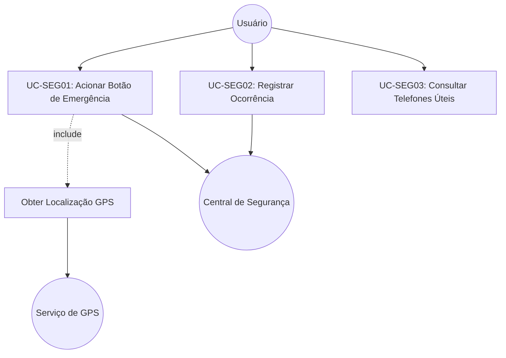
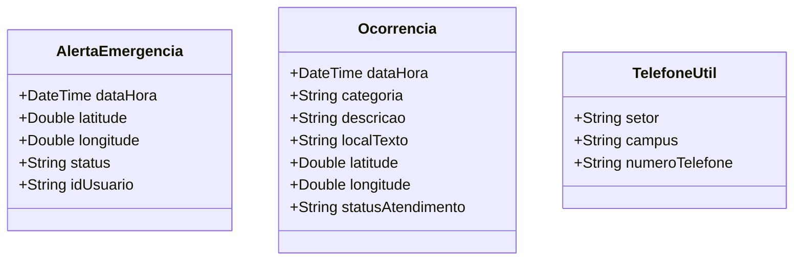

# [ANA-MOD1] Análise de Requisitos — Módulo 1: Segurança

- **Módulo:** Módulo 1 — Segurança
- **Seção:** 02-Análise
- **Autor(a):** 
- **Revisor(a):** 
- **Data de Elaboração:** 2026-10-19
- **Data da Última Revisão:** [Aguardando Revisão]
- **Status do Artefato:** [Em Elaboração / Proposta Inicial de Modelagem]
- **Uso de IA:** [Registrar em apendices/registro-ia/prompts-e-ferramentas.md caso utilize IA para refinar os diagramas]

---

## 1. Perspectiva Comportamental (Interações)

### 1.1 Atores Identificados (Proposta)
- **Usuário do App (Discente / Docente / Servidor / Visitante):** Ator primário que aciona apoio ou registra ocorrência.
- **Central de Vigilância e Segurança da UFG:** Ator receptor que gerencia os chamados e atendimento presencial.
- **Serviço de GPS do Dispositivo:** Sistema de suporte para obtenção de coordenadas geográficas.

### 1.2 Casos de Uso Identificados
- **UC-SEG01: Acionar Botão de Emergência**
  - *Objetivo:* Enviar solicitação de socorro imediato com coordenadas geográficas para a central.
  - *Fluxo Básico (a ser detalhado e refinado pelo autor):*
    1. O usuário aciona o botão de emergência.
    2. O aplicativo obtém a localização geográfica atual.
    3. O aplicativo envia os dados do alerta para a Central de Segurança.
    4. O aplicativo exibe confirmação e opção de ligação direta para a vigilância.
- **UC-SEG02: Registrar Ocorrência no Câmpus**
  - *Objetivo:* Cadastrar relato de evento ocorrido nas dependências da universidade com detalhes e anexos.
- **UC-SEG03: Consultar Telefones Úteis da Vigilância**
  - *Objetivo:* Apresentar catálogo de contatos telefônicos diretos da segurança por câmpus.

### 1.3 Diagrama de Casos de Uso (UML / Mermaid)

---

## 2. Perspectiva Estrutural (Informações)

### 2.1 Modelo Conceitual de Classes de Domínio (Proposta Inicial)

---

## 3. Diretrizes para o Autor e Revisor
- [ ] O autor deve verificar se o fluxo do caso de uso do botão de emergência atende aos requisitos levantados na eliciação.
- [ ] O revisor deve inspecionar a consistência dos atributos das classes de domínio em relação aos dados exigidos pelas ocorrências reais.

## 4. Referências Bibliográficas
- [SWEBOK, 2024] Software Requirements - Analysis Fundamentals.
- [ISO/IEC/IEEE, 2018] 29148:2018 - Systems and software engineering.
