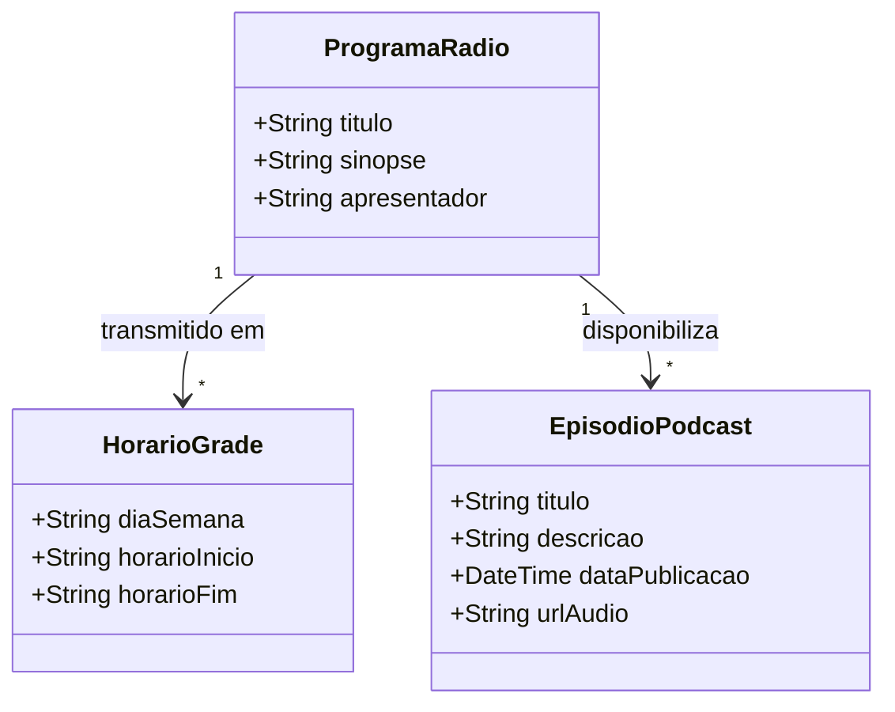

# [ANA-MOD2] Análise de Requisitos — Módulo 2: Rádio UFG

- **Módulo:** Módulo 2 — Rádio UFG
- **Seção:** 02-Análise
- **Autor(a):** 
- **Revisor(a):** 
- **Data de Elaboração:** 2026-10-19
- **Data da Última Revisão:** [Aguardando Revisão]
- **Status do Artefato:** [Em Elaboração / Proposta Inicial de Modelagem]
- **Uso de IA:** [Registrar em apendices/registro-ia/prompts-e-ferramentas.md caso utilize IA]

---

## 1. Perspectiva Comportamental (Interações)

### 1.1 Atores Identificados (Proposta)
- **Ouvinte (Usuário Final):** Interage com o player, consulta horários e seleciona conteúdos.
- **Servidor de Streaming da Rádio:** Fornece o fluxo contínuo de áudio pela rede.
- **Gerenciador de Mídia do SO:** Sistema operacional do smartphone que gerencia notificações de mídia e execução em segundo plano.

### 1.2 Casos de Uso Identificados
- **UC-RAD01: Reproduzir Streaming ao Vivo**
  - *Fluxo Básico:* O usuário clica no botão reproduzir; o app conecta ao fluxo de streaming da 108,5 FM e inicia a reprodução do áudio.
- **UC-RAD02: Consultar Grade Semanal de Programação**
  - *Fluxo Básico:* O usuário visualiza os programas e faixas de horário do dia selecionado.
- **UC-RAD03: Reproduzir Podcasts / Áudios Gravados**
  - *Fluxo Básico:* O usuário pesquisa ou navega pela lista de episódios gravados e aciona a reprodução com controle de progresso.

---

## 2. Perspectiva Estrutural (Informações)

### 2.1 Modelo Conceitual de Classes de Domínio (Proposta Inicial)

---

## 3. Diretrizes para o Autor e Revisor
- [ ] O autor deve validar a viabilidade do streaming em segundo plano e os campos da grade com a equipe da rádio.
- [ ] O revisor deve verificar se os fluxos de áudio gravado e ao vivo estão adequadamente modelados.

## 4. Referências Bibliográficas
- [SWEBOK, 2024] e [ISO/IEC/IEEE, 2018] 29148:2018.
