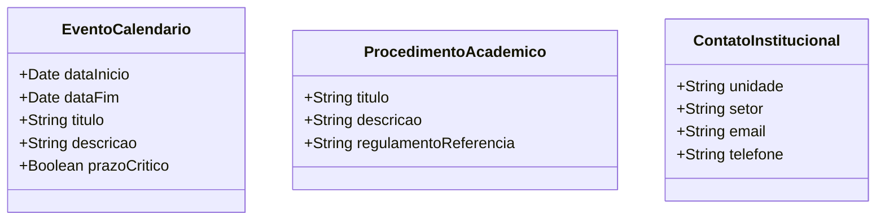

# [ANA-MOD3] Análise de Requisitos — Módulo 3: Guia Estudantil

- **Módulo:** Módulo 3 — Guia Estudantil
- **Seção:** 02-Análise
- **Autor(a):** 
- **Revisor(a):** 
- **Data de Elaboração:** 2026-10-19
- **Data da Última Revisão:** [Aguardando Revisão]
- **Status do Artefato:** [Em Elaboração / Proposta Inicial de Modelagem]
- **Uso de IA:** [Registrar em apendices/registro-ia/prompts-e-ferramentas.md caso utilize IA]

---

## 1. Perspectiva Comportamental (Interações)

### 1.1 Atores Identificados (Proposta)
- **Discente:** Usuário que consulta regulamentos, procedimentos e prazos do calendário acadêmico.
- **Sistemas Acadêmicos UFG:** Fonte de dados de normas e datas do calendário.

### 1.2 Casos de Uso Identificados
- **UC-GUI01: Consultar Calendário Acadêmico Oficial**
- **UC-GUI02: Consultar Procedimentos da Vida Acadêmica**
- **UC-GUI03: Consultar Diretório de Contatos Institucionais**

---

## 2. Perspectiva Estrutural (Informações)

### 2.1 Modelo Conceitual de Classes de Domínio (Proposta Inicial)

---

## 3. Diretrizes para o Autor e Revisor
- [ ] O autor deve checar quais procedimentos acadêmicos são mais procurados (ex: trancamento, quebra de pré-requisito).
- [ ] O revisor deve validar a clareza e hierarquia das entidades de procedimentos e contatos.

## 4. Referências Bibliográficas
- Regulamento Geral dos Cursos de Graduação (RGCG - UFG).
- [ISO/IEC/IEEE, 2018] 29148:2018.
