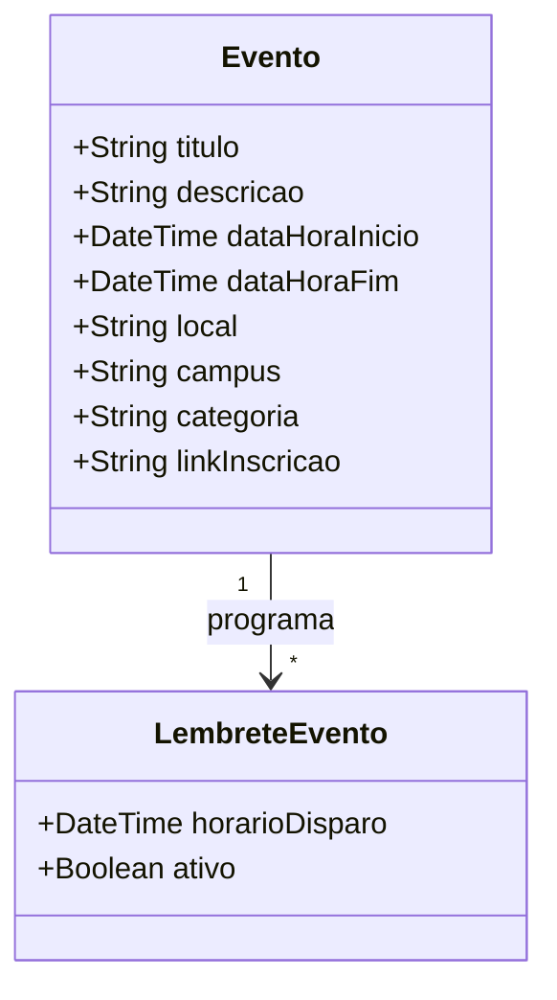

# [ANA-MOD4] Análise de Requisitos — Módulo 4: Eventos

- **Módulo:** Módulo 4 — Eventos
- **Seção:** 02-Análise
- **Autor(a):** 
- **Revisor(a):** 
- **Data de Elaboração:** 2026-10-19
- **Data da Última Revisão:** [Aguardando Revisão]
- **Status do Artefato:** [Em Elaboração / Proposta Inicial de Modelagem]
- **Uso de IA:** [Registrar em apendices/registro-ia/prompts-e-ferramentas.md caso utilize IA]

---

## 1. Perspectiva Comportamental (Interações)

### 1.1 Atores Identificados (Proposta)
- **Usuário Discente/Docente:** Consulta a programação, filtra por datas e favorita eventos.
- **Serviço de Alertas / Calendário:** Gerencia os lembretes locais programados para o evento.

### 1.2 Casos de Uso Identificados
- **UC-EVE01: Consultar Agenda de Eventos da UFG**
- **UC-EVE02: Filtrar Eventos por Câmpus e Data**
- **UC-EVE03: Favoritar Evento e Configurar Lembretes**
- **UC-EVE04: Acessar Inscrição do Evento**

---

## 2. Perspectiva Estrutural (Informações)

### 2.1 Modelo Conceitual de Classes de Domínio (Proposta Inicial)

---

## 3. Diretrizes para o Autor e Revisor
- [ ] O autor deve mapear se os eventos são cadastrados localmente ou importados do portal institucional da UFG.
- [ ] O revisor deve validar a completude dos filtros previstos na definição (por regional e por data).

## 4. Referências Bibliográficas
- [SWEBOK, 2024] e [ISO/IEC/IEEE, 2018] 29148:2018.
