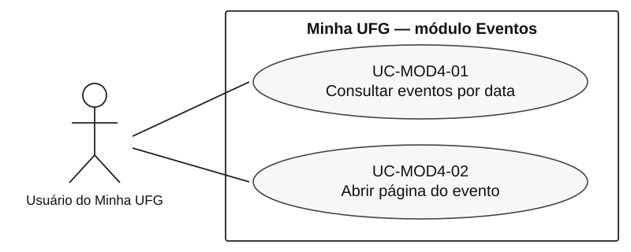
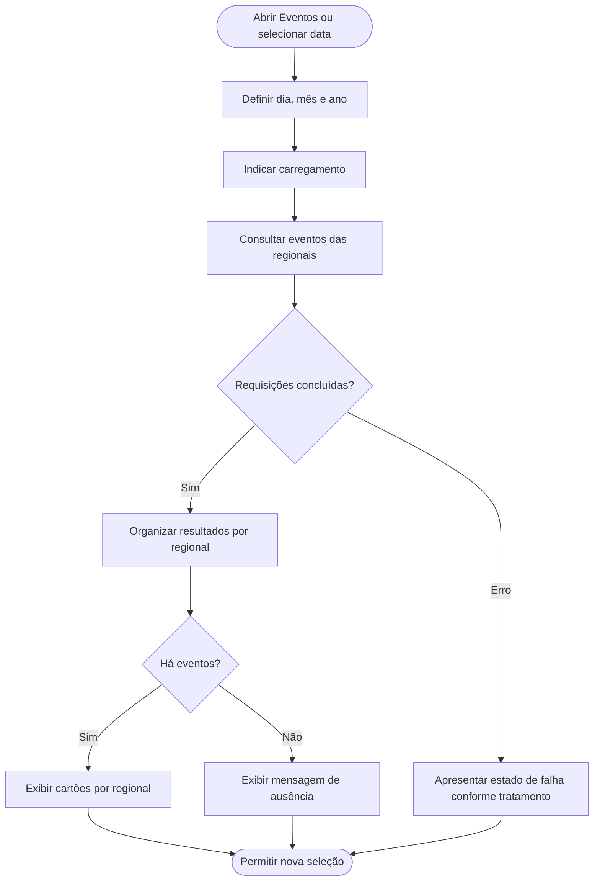
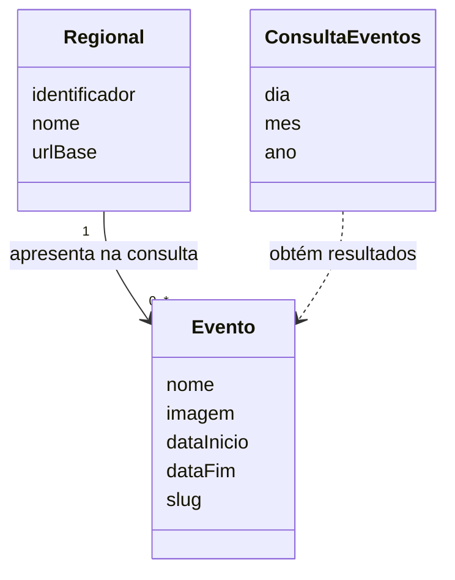

# Eventos — Análise de requisitos (AN-MOD4-01)
**Autor:** Paulo de Tarso Rezende Lôbo · **Revisor:** a registrar após revisão independente · **Base:** EL-MOD4-01.

## 1. Contexto, fronteira e conceitos
**Ator principal:** pessoa que utiliza o Minha UFG para consultar eventos. **Sistema de interesse:** módulo Eventos do aplicativo móvel. **Sistemas externos:** serviço de eventos da UFG consultado por HTTP e páginas institucionais abertas em visualizador web integrado. A produção editorial, publicação, gestão de eventos e regras internas do serviço remoto não pertencem à fronteira do módulo cliente observada.
**Objetivo do usuário:** localizar eventos vinculados à data de interesse, identificar a regional e consultar os detalhes do evento escolhido.

## 1.1. Usuários, stakeholders e domínio específico
O domínio abrangido é a divulgação de eventos institucionais por regional e data no aplicativo móvel Minha UFG. O **ator primário** é o usuário do aplicativo, incluindo integrantes da comunidade universitária e visitantes que consultam a agenda. Não foi identificada exigência de autenticação no fluxo analisado. São **partes interessadas** na informação publicada: público interessado nos eventos, unidades/organizadores que divulgam atividades e responsáveis institucionais pelo conteúdo do serviço. Os organizadores e administradores de conteúdo não são tratados como atores do cliente móvel, pois criar e editar eventos não integra a funcionalidade estudada. **Fontes de dados externas:** serviço de eventos e páginas da regional; seus mantenedores interessam à confiabilidade da informação, mas o cliente não define suas regras editoriais. Este mapeamento identifica papéis de domínio, sem afirmar entrevistas ou aprovação por tais interessados.

## 2. Casos de uso
**UC-MOD4-01 — Consultar eventos por data e regional**
- Gatilho: usuário abre Eventos.
- Pré-condição: aplicativo aberto; acesso à funcionalidade.
- Principal: (1) módulo inicializa calendário no mês/ano corrente, selecionando o dia corrente; (2) consulta a lista de regionais por data; (3) organiza eventos retornados em grupos por regional; (4) apresenta cartões contendo identificação e intervalo de realização.
- Variação A: usuário navega para mês anterior/seguinte, preservando o número do dia selecionado e renovando a consulta.
- Variação B: usuário escolhe dia do mês exibido, mudando a data da consulta.
- Alternativa: sem eventos retornados, apresenta estado vazio com mensagem explicativa.
- Exceção: erro da consulta conduz ao tratamento de erro e encerramento previsto do carregamento; travamentos observados registrados em ACH-MOD4-01/02.

**UC-MOD4-02 — Abrir página de evento**
- Gatilho: usuário seleciona um cartão na lista.
- Principal: (1) módulo identifica `slug` do evento e URL da regional; (2) verifica conectividade; (3) forma o endereço da página desse evento; (4) solicita abertura no visualizador integrado.
- Exceção: falha de conectividade é encaminhada ao tratamento de erro do módulo.

## 3. UML — Casos de uso

**Fonte editável:** [eventos-casos-de-uso.puml](./eventos-casos-de-uso.puml). O usuário consulta eventos por data e abre a página específica de um evento. As associações são linhas simples entre ator e casos de uso.

## 4. Modelo UML — Atividades da consulta

O fluxo apresenta a intenção funcional identificada; a falha observada de carregamento pode impedir o retorno normal.

## 5. Modelo UML — Classes conceituais

**Cardinalidade conceitual:** uma regional pode apresentar zero ou mais eventos no resultado; cada item é exibido em um agrupamento regional. Isso não impõe regra de persistência no serviço.

## 6. Regras e dependências
| ID | Regra / dependência | Evidências |
|---|---|---|
| RN-MOD4-01 | Dia selecionável pertence ao mês corrente exibido na grade. | EV-MOD4-05 |
| RN-MOD4-02 | Mudar o mês altera mês/ano, preservando o número do dia; rolagem de ano ocorre em dezembro/janeiro. | EV-MOD4-03/04 |
| RN-MOD4-03 | A consulta por regional é parametrizada por uma data e limita a página inicial a 50 resultados por regional no código examinado. | EV-MOD4-06 |
| RN-MOD4-04 | Regionais sem eventos no resultado não produzem seção na lista. | EV-MOD4-07 |
| RN-MOD4-05 | O endereço do detalhe é montado com URL da regional e slug do evento selecionado. | EV-MOD4-09/10 |

**Dependências:** conectividade e resposta do serviço de eventos; dados de regionais; renderização de calendário; visualizador web para detalhes. A semântica de inclusão de um evento multidiário nos resultados é responsabilidade da consulta remota e requer confronto de evidências de execução, não formulação de algoritmo cliente inexistente.

## 7. Análise de qualidade e IHC
- **Responsividade temporal:** carregamentos prolongados e interface bloqueada prejudicam operação; ACH-MOD4-01/02.
- **Recuperabilidade:** indicador que persiste após sair da tela impede continuidade de uso; ACH-MOD4-01.
- **Consistência de navegação:** consultas concorrentes não apresentam cancelamento explícito no componente; verificar comportamento de respostas antigas.
- **IHC/acessibilidade:** seleção de data e estados de carregamento devem ser perceptíveis; testes assistivos específicos não foram executados.

## 8. Conferência de consistência entre perspectivas
| Elemento comportamental | Informação necessária | Especificação vinculada | Conferência |
|---|---|---|---|
| UC-MOD4-01: selecionar data | ConsultaEventos (dia, mês, ano) | RF-MOD4-02/03; RD-MOD4-01 | A data selecionada fundamenta a consulta |
| UC-MOD4-01: listar resultados | Regional e Evento | RF-MOD4-04/05; RD-MOD4-02/03/04 | O agrupamento depende da regional; lista vazia é alternativa |
| UC-MOD4-02: abrir detalhe | Regional.urlBase; Evento.slug | RF-MOD4-06; RD-MOD4-02/03 | O cartão acionado fornece o endereço correspondente |
| Exceção da consulta | Estado de carregamento | RF-MOD4-07; RQ-MOD4-01 | ACH-MOD4-01 registra não conformidade observada; não é fluxo desejado |
A cardinalidade do modelo de classes refere-se ao **resultado exibido por regional**, não ao banco de dados ou à administração do portal. A descrição de uma data preservada ao navegar entre meses aparece como regra em RN-MOD4-02 e evidência em EV-MOD4-04; não deve ser multiplicada como requisito independente.

## 9. Rastreabilidade
UC-MOD4-01 ← EV-MOD4-01–08,11–12 → RF-MOD4-01–05; UC-MOD4-02 ← EV-MOD4-09–10 → RF-MOD4-06.  
ACH-MOD4-01–04 → verificação de qualidade/inspeções na seção 4.

## Referências
EL-MOD4-01; UFG, enunciado APS INF0339, 2026/2; APK do Minha UFG (`chunk-G3TIIQWE.js`, `chunk-OTRVJJES.js`, exame estático 22/10/2026). Modelos construídos com auxílio do ChatGPT, a citar com prompts completos no apêndice geral.
