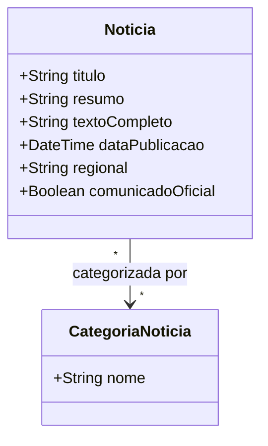

# [ANA-MOD5] Análise de Requisitos — Módulo 5: Notícias

- **Módulo:** Módulo 5 — Notícias
- **Seção:** 02-Análise
- **Autor(a):** 
- **Revisor(a):** 
- **Data de Elaboração:** 2026-10-19
- **Data da Última Revisão:** [Aguardando Revisão]
- **Status do Artefato:** [Em Elaboração / Proposta Inicial de Modelagem]
- **Uso de IA:** [Registrar em apendices/registro-ia/prompts-e-ferramentas.md caso utilize IA]

---

## 1. Perspectiva Comportamental (Interações)

### 1.1 Atores Identificados (Proposta)
- **Leitor da Comunidade:** Navega pelas notícias, filtra por unidade/regional e busca por texto.
- **Serviço de Notícias UFG:** Fornece as matérias institucionais publicadas.
- **Serviço de Notificações:** Entrega avisos sobre comunicados oficiais urgentes.

### 1.2 Casos de Uso Identificados
- **UC-NOT01: Visualizar Feed de Notícias**
- **UC-NOT02: Filtrar Notícias por Regional / Unidade**
- **UC-NOT03: Pesquisar Notícias por Palavras-Chave**
- **UC-NOT04: Receber Alertas de Comunicados Oficiais**

---

## 2. Perspectiva Estrutural (Informações)

### 2.1 Modelo Conceitual de Classes de Domínio (Proposta Inicial)

---

## 3. Diretrizes para o Autor e Revisor
- [ ] O autor deve mapear se os comunicados oficiais devem ter destaque visual fixo no topo do feed.
- [ ] O revisor deve verificar a coerência das categorias de notícias com as regionais da UFG.

## 4. Referências Bibliográficas
- [SWEBOK, 2024] e [ISO/IEC/IEEE, 2018] 29148:2018.
