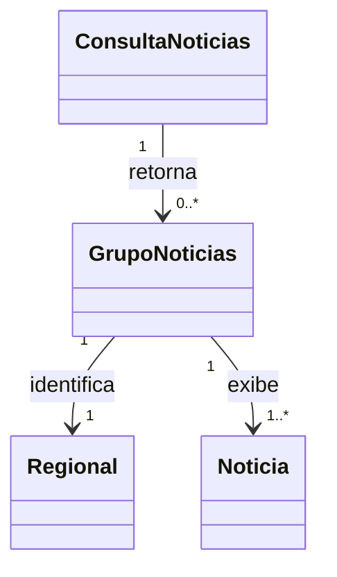

# Cardinalidades verificadas — Notícias

A análise refere-se ao resultado da consulta, não ao banco de dados do servidor.

- Uma consulta apresenta zero ou mais grupos regionais.
- Cada grupo regional apresentado tem uma única regional identificadora.
- Cada grupo efetivamente apresentado contém uma ou mais notícias; grupos vazios não são exibidos.
- Cada notícia exibida pertence a um grupo regional naquela resposta; isto não afirma vínculo editorial permanente.
- Páginas subsequentes podem acrescentar notícias a grupos já visíveis.

Modelo conceitual:

O diagrama de classes do arquivo noticias.md utiliza uma relação simplificada. Este modelo detalhado esclarece a semântica das cardinalidades sem afirmar uma estrutura de persistência. Revisão humana independente ainda necessária.
