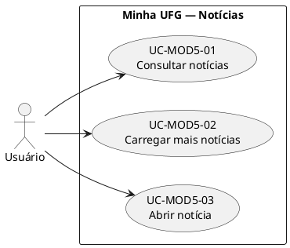
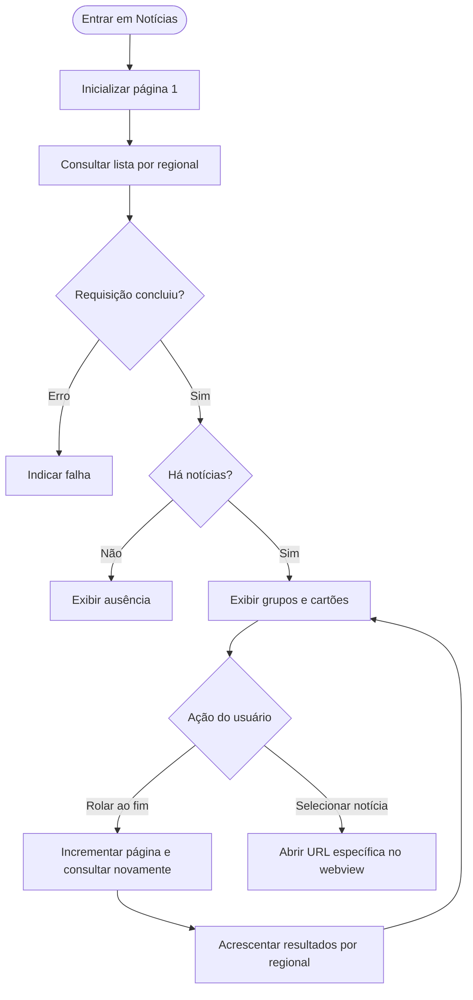
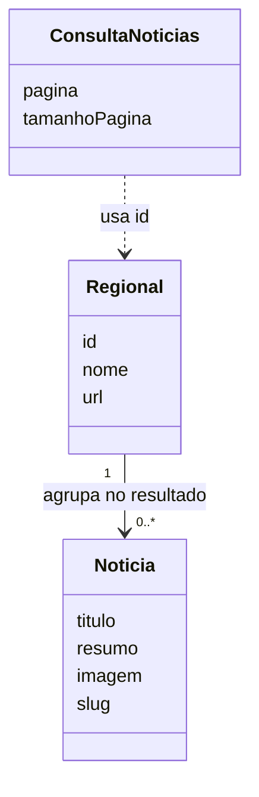

# Notícias — Análise e modelagem (AN-MOD5-01)
**Autor:** Paulo de Tarso Rezende Lôbo · **Revisor:** pendente de execução · **Fonte:** EL-MOD5-01.
## 1. Domínio, usuários e fronteira
O módulo Notícias permite consultar informações de acontecimentos associados às regionais da UFG. **Ator principal:** usuário do aplicativo móvel, seja membro da comunidade UFG ou visitante interessado; autenticação não é exigida pelo fluxo identificado no componente estudado. **Stakeholders:** leitores das notícias, regionais e unidades divulgadoras, responsáveis editoriais institucionais e equipes mantenedoras do serviço de conteúdo. Os dois últimos grupos não são automaticamente atores do aplicativo: produção e administração editorial pertencem a sistemas externos. **Fronteira do módulo:** solicitar páginas, organizar grupos por regional, exibir resumo e abrir página do item. Fora da fronteira: publicação, revisão editorial e armazenamento dos textos completos no portal.
## 2. Casos de uso
**UC-MOD5-01 — Consultar notícias das regionais.** Ator: usuário. Gatilho: abrir Notícias. Principal: inicializar página 1; consultar notícias por regional; apresentar grupos com título e cartões com imagem/título/resumo. Alternativa: exibir mensagem de ausência quando o resultado agregado estiver vazio. Exceção: falha de requisição, alerta ao usuário.  
**UC-MOD5-02 — Carregar notícias adicionais.** Ator: usuário. Gatilho: alcançar final da lista. Principal: incrementar página; consultar mais registros; acrescentar notícias às coleções já exibidas ou criar grupo de regional quando necessário. Exceção: falha da nova consulta, aviso ao usuário.  
**UC-MOD5-03 — Abrir notícia.** Ator: usuário. Gatilho: selecionar um cartão. Principal: obter URL base da regional e slug; construir endereço `/n/<slug>`; solicitar exibição em webview. Exceção: indisponibilidade de conexão/timeout, exibir alerta.
## 3. UML — casos de uso (PlantUML)

## 4. UML — atividade

## 5. UML — classes conceituais

Modelo conceitual de resultado, não afirma banco, regras editoriais nem persistência local.
## 6. Regras e dependências
| ID | Análise | Evidências |
|---|---|---|
| RN-MOD5-01 | A consulta informa regional, página e quantidade de até 10 notícias solicitadas por página. | EV-03 |
| RN-MOD5-02 | Na primeira página, grupos são reconstruídos; páginas posteriores agregam registros aos grupos existentes. | EV-04/06 |
| RN-MOD5-03 | Só são exibidos grupos com ao menos uma notícia no resultado. | EV-04 |
| RN-MOD5-04 | A URL de uma notícia usa URL base da regional e `slug` do item acionado. | EV-08 |
Dependências externas: catálogo das regionais, serviço HTTP de notícias, rede e portal/webview. **IHC:** título de página, distinção dos agrupamentos, informações resumidas e indicador de carregamento são os elementos observáveis; recomenda-se inspeção de legibilidade e tecnologia assistiva, sem declarar certificação de acessibilidade.
## 7. Rastreabilidade
UC-MOD5-01 ↔ EV-MOD5-01–05/07/09; UC-MOD5-02 ↔ EV-MOD5-03/06; UC-MOD5-03 ↔ EV-MOD5-08/09. Requisitos detalhados: ESP-MOD5-01.
## Referências
EL-MOD5-01; UFG, APS INF0339 2026/2; análise estática do arquivo `chunk-B77HEVFE.js` (22/10/2026). Uso de IA: consolidar os prompts aplicáveis no apêndice geral.
