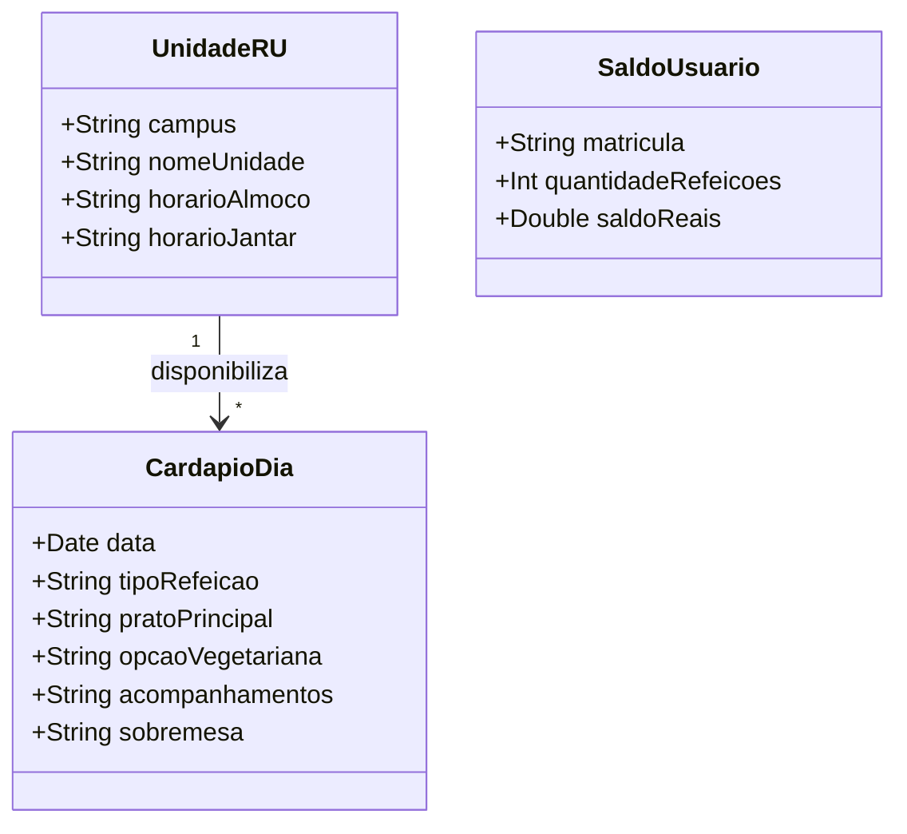

# [ANA-MOD6] Análise de Requisitos — Módulo 6: Restaurante Universitário (RU)

- **Módulo:** Módulo 6 — Restaurante Universitário (RU)
- **Seção:** 02-Análise
- **Autor(a):** 
- **Revisor(a):** 
- **Data de Elaboração:** 2026-10-19
- **Data da Última Revisão:** [Aguardando Revisão]
- **Status do Artefato:** [Em Elaboração / Proposta Inicial de Modelagem]
- **Uso de IA:** [Registrar em apendices/registro-ia/prompts-e-ferramentas.md caso utilize IA]

---

## 1. Perspectiva Comportamental (Interações)

### 1.1 Atores Identificados (Proposta)
- **Comensal (Usuário):** Consulta o cardápio e verifica saldo de créditos antes das refeições.
- **Sistema de Controle de Acesso/Créditos do RU:** Fonte de dados sobre saldo de refeições.
- **Setor de Nutrição / PRAE:** Responsável pela alimentação dos cardápios e comunicados do RU.

### 1.2 Casos de Uso Identificados
- **UC-RU01: Consultar Cardápio do Dia e da Semana por Câmpus**
- **UC-RU02: Consultar Horários de Funcionamento das Unidades**
- **UC-RU03: Consultar Saldo de Créditos e Histórico de Refeições**
- **UC-RU04: Visualizar Avisos e Comunicados do RU**

---

## 2. Perspectiva Estrutural (Informações)

### 2.1 Modelo Conceitual de Classes de Domínio (Proposta Inicial)

---

## 3. Diretrizes para o Autor e Revisor
- [ ] O autor deve validar a diferenciação dos cardápios entre Câmpus Samambaia (RU 1 e 2), Colemar e Câmpus Goiás.
- [ ] O revisor deve validar a precisão dos horários e regras de exibição do saldo.

## 4. Referências Bibliográficas
- [SWEBOK, 2024] e [ISO/IEC/IEEE, 2018] 29148:2018.
- Normas de Funcionamento do RU - PRAE/UFG.
