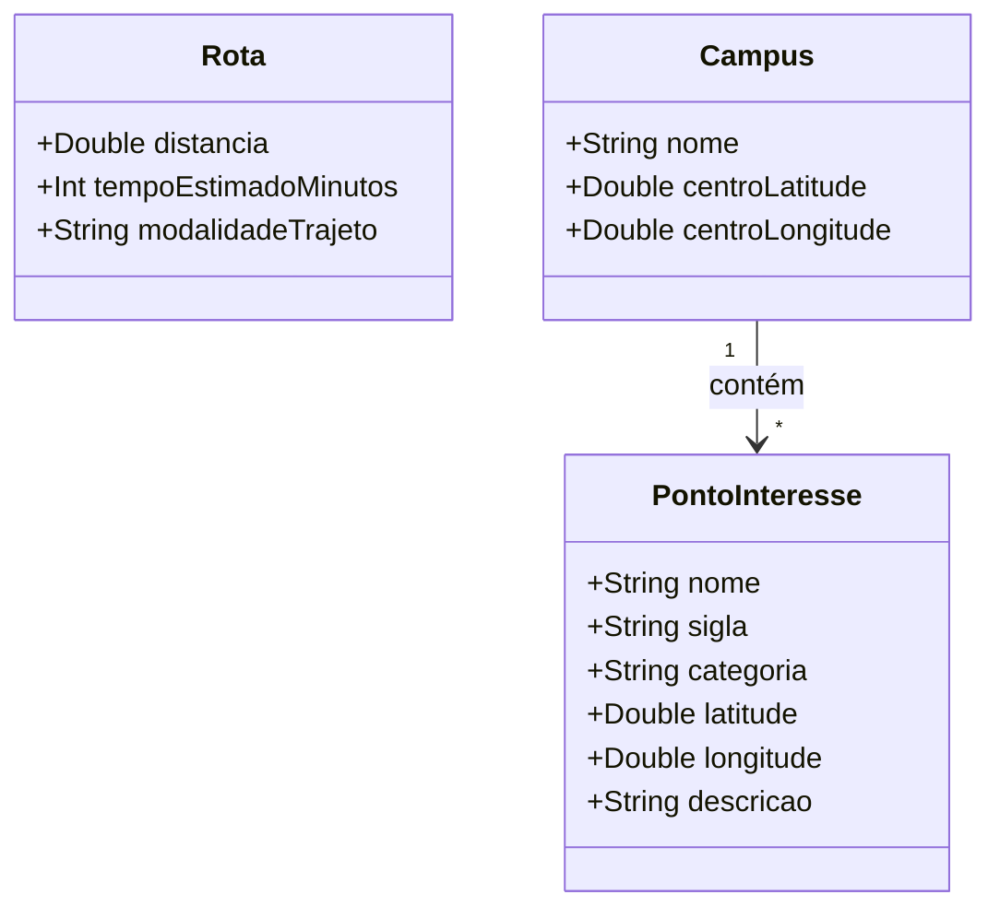

# [ANA-MOD7] Análise de Requisitos — Módulo 7: Locais e Navegação

- **Módulo:** Módulo 7 — Locais
- **Seção:** 02-Análise
- **Autor(a):** 
- **Revisor(a):** 
- **Data de Elaboração:** 2026-10-19
- **Data da Última Revisão:** [Aguardando Revisão]
- **Status do Artefato:** [Em Elaboração / Proposta Inicial de Modelagem]
- **Uso de IA:** [Registrar em apendices/registro-ia/prompts-e-ferramentas.md caso utilize IA]

---

## 1. Perspectiva Comportamental (Interações)

### 1.1 Atores Identificados (Proposta)
- **Usuário:** Interage com o mapa interativo, busca prédios e traça rotas nos câmpus.
- **Serviço de Cartografia e Rotas:** Sistema que provê visualização de mapa e cálculo de caminhos.
- **Sensor de GPS:** Provedor da posição em tempo real do usuário.

### 1.2 Casos de Uso Identificados
- **UC-LOC01: Visualizar Mapa Interativo dos Câmpus**
- **UC-LOC02: Buscar Prédios, Faculdades e Laboratórios**
- **UC-LOC03: Traçar Rotas de Navegação Interna**
- **UC-LOC04: Visualizar Pontos de Interesse (POIs)**

---

## 2. Perspectiva Estrutural (Informações)

### 2.1 Modelo Conceitual de Classes de Domínio (Proposta Inicial)

---

## 3. Diretrizes para o Autor e Revisor
- [ ] O autor deve mapear as siglas mais usuais (ex: INF, IME, CAB, CAA, Reitoria, BS) para garantir que a busca funcione pelo vocabulário dos discentes.
- [ ] O revisor deve inspecionar a modelagem das rotas e a viabilidade dos pontos de interesse.

## 4. Referências Bibliográficas
- [SWEBOK, 2024] e [ISO/IEC/IEEE, 2018] 29148:2018.
