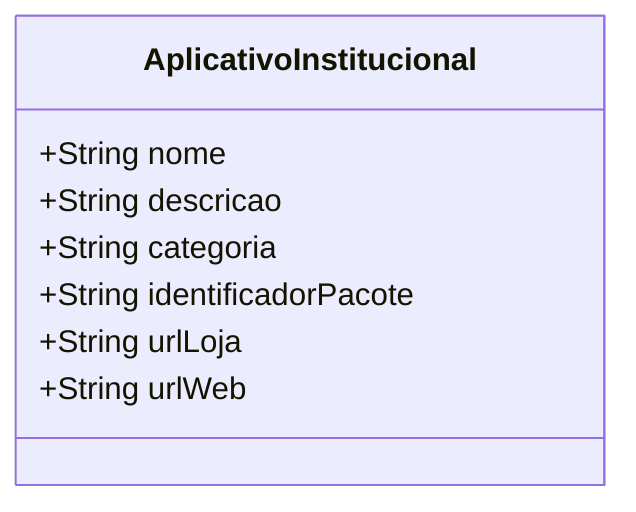

# [ANA-MOD8] Análise de Requisitos — Módulo 8: Apps UFG

- **Módulo:** Módulo 8 — Apps UFG
- **Seção:** 02-Análise
- **Autor(a):** 
- **Revisor(a):** 
- **Data de Elaboração:** 2026-10-19
- **Data da Última Revisão:** [Aguardando Revisão]
- **Status do Artefato:** [Em Elaboração / Proposta Inicial de Modelagem]
- **Uso de IA:** [Registrar em apendices/registro-ia/prompts-e-ferramentas.md caso utilize IA]

---

## 1. Perspectiva Comportamental (Interações)

### 1.1 Atores Identificados (Proposta)
- **Usuário da Comunidade:** Navega pelo catálogo institucional e seleciona um serviço ou app.
- **Sistema Operacional do Dispositivo:** Detecta se o aplicativo já está instalado no aparelho.
- **Lojas Oficiais de Aplicativos (Google Play / Apple Store):** Plataformas para download e instalação.

### 1.2 Casos de Uso Identificados
- **UC-APP01: Listar Catálogo de Aplicativos da UFG**
- **UC-APP02: Abrir Aplicativo Instalado no Aparelho**
- **UC-APP03: Redirecionar para Loja Oficial para Instalação**
- **UC-APP04: Redirecionar para Versão Web Institucional**

---

## 2. Perspectiva Estrutural (Informações)

### 2.1 Modelo Conceitual de Classes de Domínio (Proposta Inicial)

---

## 3. Diretrizes para o Autor e Revisor
- [ ] O autor deve mapear a lista completa de aplicativos oficiais mantidos pela SeTI/UFG (ex: SIGAA Mobile, SABI/Biblioteca, etc.).
- [ ] O revisor deve validar a viabilidade de verificação de pacotes instalados em Android e iOS.

## 4. Referências Bibliográficas
- [SWEBOK, 2024] e [ISO/IEC/IEEE, 2018] 29148:2018.
