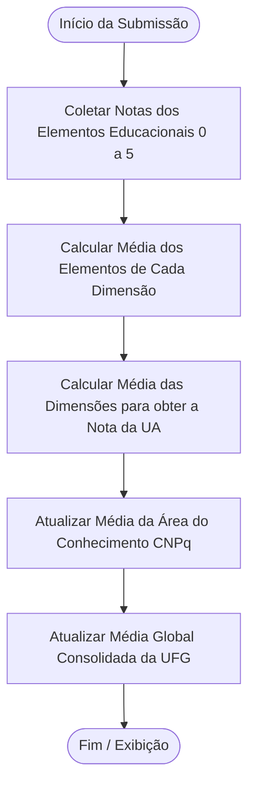
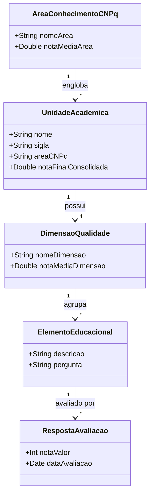

# [ANA-MOD9] Análise de Requisitos — Módulo 9: Evolução (Avaliação de Unidades Acadêmicas)

- **Módulo:** Módulo 9 — Evolução: Avaliação de Unidades Acadêmicas (UAs)
- **Seção:** 02-Análise
- **Autor(a):** 
- **Revisor(a):** 
- **Data de Elaboração:** 2026-10-19
- **Data da Última Revisão:** [Aguardando Revisão]
- **Status do Artefato:** [Em Elaboração / Proposta Baseada no Apêndice A]
- **Uso de IA:** [Registrar em apendices/registro-ia/prompts-e-ferramentas.md caso utilize IA]

---

## 1. Perspectiva Comportamental (Interações)

### 1.1 Atores Identificados
- **Membro da Comunidade Acadêmica (Avaliador):** Discente, docente ou servidor que preenche e envia as notas de avaliação de uma UA.
- **Consultor da Comunidade:** Usuário que acessa as notas individuais, por área do CNPq ou a média geral da UFG.
- **Sistema de Processamento Estatístico:** Módulo que recalcula as médias aritméticas a cada submissão.

### 1.2 Casos de Uso Identificados (Conforme Apêndice A)
- **UC-AVA01: Avaliar Qualidade de Unidade Acadêmica**
  - *Fluxo Principal:*
    1. O usuário seleciona a Unidade Acadêmica (UA).
    2. O app apresenta o formulário com as dimensões de qualidade e seus respectivos elementos educacionais.
    3. O usuário atribui nota de 0 a 5 para cada questão.
    4. O usuário confirma o envio.
    5. O sistema registra a avaliação e atualiza as médias correspondentes.
- **UC-AVA02: Consultar Avaliação por Unidade Acadêmica Individual**
- **UC-AVA03: Consultar Avaliação Média por Grande Área do Conhecimento (CNPq)**
- **UC-AVA04: Consultar Avaliação Geral da UFG (Média Global de todas as UAs)**

### 1.3 Diagrama de Atividades: Processamento das Médias (Regra Oficial do Apêndice A)

---

## 2. Perspectiva Estrutural (Informações)

### 2.1 Modelo Conceitual de Classes de Domínio

---

## 3. Regras de Negócio Oficiais (Extraídas do Apêndice A)
- **RN-AVA01 (Escala de Notas):** Cada questão sobre elemento educacional deve receber nota inteira entre 0 (péssima) e 5 (excelente).
- **RN-AVA02 (Nota da Dimensão):** A média simples das notas dos elementos educacionais determina a nota da dimensão de qualidade.
- **RN-AVA03 (Nota da UA):** A média simples das notas das dimensões de qualidade determina a nota final da Unidade Acadêmica.
- **RN-AVA04 (Média por Área CNPq):** Média aritmética das notas finais de todas as UAs pertencentes à mesma grande área do CNPq.
- **RN-AVA05 (Média Global UFG):** Média aritmética das notas finais de todas as UAs da universidade.

## 4. Referências Bibliográficas
- Apêndice A da APS - INF0339 (2026/2).
- Tabela de Áreas do Conhecimento do CNPq.
- [SWEBOK, 2024] e [ISO/IEC/IEEE, 2018] 29148:2018.
