# INF 0339 - Engenharia de Requisitos (2026/2)
## Atividades Práticas Supervisionadas (APS) — Sistema de Informação Minha UFG

**Universidade Federal de Goiás – Instituto de Informática**  
**Bacharelado em Ciência da Computação**  
**Equipe:** Leste  
**Arquivo de Entrega:** `INF0339-APS-Leste.pdf`

---

### Autoria (em ordem alfabética estrita):
1. **Adriano Coelho Leão Filho**
2. **Carlos Andre Scherer**
3. **Iago Pimentel Zimerer Barreira**
4. **João Victor Otto Nascimento**
5. **Milena Oliveira Penhalves**
6. **Paulo de Tarso Rezende Lôbo**
7. **Victor Manoel Silva Nascimento**

---

### Sumário Executivo do Documento
1. **Seção 1 — Eliciação de Requisitos** (Módulos 1 a 9)
2. **Seção 2 — Análise de Requisitos** (Perspectiva Comportamental e Estrutural)
3. **Seção 3 — Especificação de Requisitos** (Requisitos Funcionais, Não-Funcionais e Regras de Negócio)
4. **Seção 4 — Validação de Requisitos** (Cenários de Aceitação BDD e Checklists de Inspeção)
5. **Seção 5 — Rastreabilidade Bidirecional e Análise de Impacto**
6. **Referências Bibliográficas**
7. **Apêndices:**
   - Apêndice I: Atas de Reuniões Síncronas
   - Apêndice II: Registro de Uso de Ferramentas de Inteligência Artificial (Regra 6)
   - Apêndice III: Registro de Decisões e Comunicação da Equipe


ewpage


# Seção 1 — Eliciação de Requisitos

A eliciação de requisitos é o processo de identificar necessidades, objetivos, restrições e expectativas dos usuários e partes interessadas (*stakeholders*) para o aplicativo **Minha UFG**.

---

## Objetivos desta Seção
1. Identificar o perfil das partes interessadas (estudantes, professores, técnicos, visitantes, vigilância, coordenadores).
2. Aplicar técnicas formais de eliciação de requisitos (SWEBOK v4, ISO/IEC/IEEE 29148:2018).
3. Mapear as necessidades reais e desejadas para cada um dos módulos do aplicativo.

---

## Técnicas Sugeridas
- **Análise Documental:** Inspeção de resoluções da UFG, manuais do estudante, regulamento do RU, grade da Rádio UFG e estatutos.
- **Engenharia Reversa / Etnografia do App Existente:** Uso do app atual em produção na Play Store / App Store para mapear comportamento atual.
- **Entrevistas e Questionários:** Pesquisa com discentes e servidores.
- **Personas e Empatia:** Construção de arquétipos de usuários representativos da UFG.
- **Brainstorming e Workshops de Requisitos:** Sessões síncronas entre os membros da equipe.

---

## Módulos nesta Seção
- `modulo-1-seguranca/`: Eliciação das demandas de segurança física, botão de emergência e canais de vigilância.
- `modulo-2-radio/`: Eliciação de streaming, consumo de rádio FM e podcasts acadêmicos.
- `modulo-3-guia-estudantil/`: Eliciação de necessidades de orientação ao calouro e veterano, trâmites e calendários.
- `modulo-4-eventos/`: Eliciação da agenda universitária, eventos esportivos e culturais, inscrições.
- `modulo-5-noticias/`: Eliciação do feed institucional, alertas da reitoria e filtros por unidade.
- `modulo-6-ru/`: Eliciação de cardápios, saldo da carteirinha, recargas e restrições alimentares.
- `modulo-7-locais/`: Eliciação do mapa do Samambaia, Colemar, Aparecida e Goiás, rotas acessíveis e busca por blocos.
- `modulo-8-apps-ufg/`: Eliciação de integração e catálogo de links/deep-links para SIGAA, Moodle e Webmail.
- `modulo-9-evolucao-avaliacao-ua/`: Eliciação da nova funcionalidade de avaliação da qualidade das Unidades Acadêmicas (dimensões de infraestrutura, corpo docente, recursos didáticos e condições ambientais).


# [ELI-MOD1] Eliciação de Requisitos — Módulo 1: Segurança

- **Módulo:** Módulo 1 — Segurança
- **Seção:** 01-Eliciação
- **Autor(a):** 
- **Revisor(a):** 
- **Data de Elaboração:** 2026-10-19
- **Data da Última Revisão:** [Aguardando Revisão]
- **Status do Artefato:** [Em Elaboração]
- **Uso de IA:** [Registrar se houver uso em apendices/registro-ia/prompts-e-ferramentas.md]

---

## 1. Escopo do Módulo (Definição da Atividade)
> **Escopo Oficial:** Botão de emergência, envio de alerta com localização, registro e acompanhamento de ocorrências no câmpus e telefones úteis da vigilância UFG.

---

## 2. Identificação de Partes Interessadas (Stakeholders)
*Tópicos para orientação e levantamento:*
- **Usuários Finais:** Estudantes, professores, técnicos-administrativos e visitantes que frequentam os câmpus (notadamente em períodos noturnos e áreas ermas).
- **Operação de Segurança:** Central de Vigilância e Segurança da UFG (DSI / SEINFRA).
- **Serviços Externos de Emergência:** Polícia Militar (PMGO), SAMU e Corpo de Bombeiros.

---

## 3. Técnicas de Eliciação Planejadas
*Ações a serem executadas pelo autor para levantar os requisitos reais:*
- [ ] **Análise do App Atual:** Inspecionar no aplicativo "Minha UFG" em produção o funcionamento atual do botão de socorro/segurança.
- [ ] **Consulta a Normas/Documentos:** Verificar os procedimentos operacionais de segurança e atendimento da vigilância da UFG.
- [ ] **Levantamento com Usuários:** Realizar entrevistas ou questionários com a comunidade acadêmica sobre percepções e demandas de segurança nos câmpus.

---

## 4. Necessidades Elicitadas (Requisitos Iniciais a Validar)
*Itens preliminares baseados no escopo oficial para refinamento pelo autor:*
- **ELI-SEG-01:** Disponibilizar botão de emergência com acionamento rápido e inequívoco.
- **ELI-SEG-02:** Mecanismo de transmissão de alerta com envio das coordenadas geográficas (GPS) para a segurança universitária.
- **ELI-SEG-03:** Funcionalidade de registro de ocorrências no câmpus (permitindo anexar detalhes, tipo e fotos).
- **ELI-SEG-04:** Acompanhamento do status de atendimento das ocorrências registradas pelo usuário.
- **ELI-SEG-05:** Lista de telefones úteis e canais diretos da vigilância por câmpus (Samambaia, Colemar, Aparecida, Goiás).

---

## 5. Referências Bibliográficas
- [SWEBOK, 2024] Guide to the Software Engineering Body of Knowledge - SWEBOK v4, Chapter 1 – Software Requirements. IEEE, 2024.
- [ISO/IEC/IEEE, 2018] International Standard 29148:2018 - Systems and software engineering – Life cycle processes – Requirements engineering.
- *(Adicionar documentos e portarias consultadas da UFG)*


---


# [ELI-MOD2] Eliciação de Requisitos — Módulo 2: Rádio UFG

- **Módulo:** Módulo 2 — Rádio UFG
- **Seção:** 01-Eliciação
- **Autor(a):** 
- **Revisor(a):** 
- **Data de Elaboração:** 2026-10-19
- **Data da Última Revisão:** [Aguardando Revisão]
- **Status do Artefato:** [Em Elaboração]
- **Uso de IA:** [Registrar se houver uso em apendices/registro-ia/prompts-e-ferramentas.md]

---

## 1. Escopo do Módulo (Definição da Atividade)
> **Escopo Oficial:** Player de streaming ao vivo da Rádio UFG 108,5 FM, grade de programação, controle de reprodução e podcasts/áudios gravados.

---

## 2. Identificação de Partes Interessadas (Stakeholders)
*Tópicos para orientação e levantamento:*
- **Ouvintes / Comunidade:** Discentes, docentes, técnicos e comunidade externa apreciadores de programação científica, cultural e musical.
- **Equipe da Rádio Universitária UFG:** Locutores, produtores e técnicos responsáveis pela transmissão e publicação de áudios.
- **Secretaria de Comunicação da UFG (Secom):** Gestão das diretrizes de comunicação institucional.

---

## 3. Técnicas de Eliciação Planejadas
*Ações a serem executadas pelo autor para levantar os requisitos reais:*
- [ ] **Análise do App Atual:** Testar o player e a exibição da grade no aplicativo "Minha UFG" existente.
- [ ] **Análise do Portal da Rádio:** Avaliar as transmissões e links de streaming disponíveis no site oficial da Rádio UFG.
- [ ] **Benchmarking:** Observar boas práticas de reprodutores de rádio web (ex: execução em segundo plano, baixo consumo de dados).

---

## 4. Necessidades Elicitadas (Requisitos Iniciais a Validar)
*Itens preliminares baseados no escopo oficial para refinamento pelo autor:*
- **ELI-RAD-01:** Transmissão em tempo real (streaming) do sinal da Rádio UFG 108,5 FM.
- **ELI-RAD-02:** Exibição da grade de programação com programas, horários e dias de veiculação.
- **ELI-RAD-03:** Controles essenciais de reprodução (play, pause, controle de volume).
- **ELI-RAD-04:** Suporte a reprodução de conteúdos sob demanda (podcasts e programas gravados).
- **ELI-RAD-05:** Manutenção da reprodução de áudio em segundo plano com o app minimizado ou tela bloqueada.

---

## 5. Referências Bibliográficas
- [SWEBOK, 2024] Guide to the Software Engineering Body of Knowledge - SWEBOK v4.
- [ISO/IEC/IEEE, 2018] International Standard 29148:2018.
- Portal Oficial da Rádio Universitária UFG (108,5 FM).


---


# [ELI-MOD3] Eliciação de Requisitos — Módulo 3: Guia Estudantil

- **Módulo:** Módulo 3 — Guia Estudantil
- **Seção:** 01-Eliciação
- **Autor(a):** 
- **Revisor(a):** 
- **Data de Elaboração:** 2026-10-19
- **Data da Última Revisão:** [Aguardando Revisão]
- **Status do Artefato:** [Em Elaboração]
- **Uso de IA:** [Registrar se houver uso em apendices/registro-ia/prompts-e-ferramentas.md]

---

## 1. Escopo do Módulo (Definição da Atividade)
> **Escopo Oficial:** Calendário acadêmico, regimentos, contatos institucionais, procedimentos e orientação para estudantes.

---

## 2. Identificação de Partes Interessadas (Stakeholders)
*Tópicos para orientação e levantamento:*
- **Estudantes (Calouros e Veteranos):** Necessitam de clareza sobre datas do semestre, trâmites de matrícula e regras da universidade.
- **Órgãos Centrais de Ensino e Assistência:** Pró-Reitoria de Graduação (PROGRAD) e Pró-Reitoria de Assuntos Estudantis (PRAE).
- **Coordenações de Curso e Secretarias de Unidades:** Pontos focais de atendimento a dúvidas acadêmicas.

---

## 3. Técnicas de Eliciação Planejadas
*Ações a serem executadas pelo autor para levantar os requisitos reais:*
- [ ] **Análise Documental:** Examinar o Regulamento Geral dos Cursos de Graduação (RGCG/UFG) e o Calendário Acadêmico Oficial em vigor.
- [ ] **Análise do App Atual:** Mapear quais documentos e guias já estão presentes no aplicativo móvel.
- [ ] **Levantamento de Dúvidas Frequentes:** Coletar procedimentos burocráticos mais recorrentes (matrícula, trancamento, aproveitamento).

---

## 4. Necessidades Elicitadas (Requisitos Iniciais a Validar)
*Itens preliminares baseados no escopo oficial para refinamento pelo autor:*
- **ELI-GUI-01:** Apresentação estruturada do calendário acadêmico oficial com visualização de períodos letivos e prazos.
- **ELI-GUI-02:** Orientações e tutoriais passo a passo sobre os procedimentos da vida acadêmica.
- **ELI-GUI-03:** Guia sobre normas, regimentos e direitos/deveres dos discentes.
- **ELI-GUI-04:** Diretório com contatos institucionais de unidades, coordenações, bibliotecas e serviços de apoio.

---

## 5. Referências Bibliográficas
- Regulamento Geral dos Cursos de Graduação (RGCG) - UFG.
- Calendário Acadêmico Oficial da UFG.
- [SWEBOK, 2024] e [ISO/IEC/IEEE, 2018] 29148:2018.


---


# [ELI-MOD4] Eliciação de Requisitos — Módulo 4: Eventos

- **Módulo:** Módulo 4 — Eventos
- **Seção:** 01-Eliciação
- **Autor(a):** 
- **Revisor(a):** 
- **Data de Elaboração:** 2026-10-19
- **Data da Última Revisão:** [Aguardando Revisão]
- **Status do Artefato:** [Em Elaboração]
- **Uso de IA:** [Registrar se houver uso em apendices/registro-ia/prompts-e-ferramentas.md]

---

## 1. Escopo do Módulo (Definição da Atividade)
> **Escopo Oficial:** Agenda de eventos acadêmicos, culturais e esportivos da UFG, opção de favoritar, lembretes e inscrição em eventos.

---

## 2. Identificação de Partes Interessadas (Stakeholders)
*Tópicos para orientação e levantamento:*
- **Participantes da Comunidade:** Discentes e servidores que buscam atividades de extensão, congressos, semanas acadêmicas e horas complementares.
- **Organizadores de Eventos:** Centros acadêmicos, faculdades, pró-reitorias (PROEC) e ligas acadêmicas.

---

## 3. Técnicas de Eliciação Planejadas
*Ações a serem executadas pelo autor para levantar os requisitos reais:*
- [ ] **Análise do App Atual:** Inspecionar como a lista de eventos é atualmente filtrada e exibida no aplicativo.
- [ ] **Análise do Portal de Eventos UFG:** Mapear categorias de eventos e mecanismos de inscrição existentes na instituição.
- [ ] **Questionário/Entrevista com Discentes:** Identificar a utilidade de alertas, lembretes e favoritos para eventos de interesse.

---

## 4. Necessidades Elicitadas (Requisitos Iniciais a Validar)
*Itens preliminares baseados no escopo oficial para refinamento pelo autor:*
- **ELI-EVE-01:** Exibição da agenda de eventos acadêmicos, culturais e esportivos da universidade.
- **ELI-EVE-02:** Mecanismo de filtragem e exploração de eventos por regional/câmpus e por data.
- **ELI-EVE-03:** Funcionalidade de favoritar eventos de interesse do usuário.
- **ELI-EVE-04:** Configuração e envio de lembretes/notificações sobre eventos favoritados.
- **ELI-EVE-05:** Mecanismo de direcionamento ou fluxo para inscrição no evento.

---

## 5. Referências Bibliográficas
- [SWEBOK, 2024] Guide to the Software Engineering Body of Knowledge.
- [ISO/IEC/IEEE, 2018] 29148:2018.
- Portal de Eventos e Extensão da UFG.


---


# [ELI-MOD5] Eliciação de Requisitos — Módulo 5: Notícias

- **Módulo:** Módulo 5 — Notícias
- **Seção:** 01-Eliciação
- **Autor(a):** 
- **Revisor(a):** 
- **Data de Elaboração:** 2026-10-19
- **Data da Última Revisão:** [Aguardando Revisão]
- **Status do Artefato:** [Em Elaboração]
- **Uso de IA:** [Registrar se houver uso em apendices/registro-ia/prompts-e-ferramentas.md]

---

## 1. Escopo do Módulo (Definição da Atividade)
> **Escopo Oficial:** Feed de notícias da UFG (filtrado por regional/unidade), notificações de comunicados oficiais e pesquisa por notícias.

---

## 2. Identificação de Partes Interessadas (Stakeholders)
*Tópicos para orientação e levantamento:*
- **Leitores da Comunidade Universitária:** Estudantes, professores e técnicos que dependem de comunicados e notícias oficiais.
- **Produtores de Conteúdo:** Jornalistas e assessores da Secretaria de Comunicação (Secom/UFG) e assessorias das unidades.
- **Administração Superior:** Emissão de comunicados urgentes (ex: suspensão de aulas, calendários especiais).

---

## 3. Técnicas de Eliciação Planejadas
*Ações a serem executadas pelo autor para levantar os requisitos reais:*
- [ ] **Análise do App Atual:** Mapear os campos e formato de exibição das notícias no aplicativo em operação.
- [ ] **Análise da Estrutura de Notícias do Portal UFG:** Mapear categorias, regionais e campos de comunicados oficiais no CMS institucional.
- [ ] **Consulta de Usabilidade:** Levantar como discentes preferem pesquisar notícias e receber alertas urgentes.

---

## 4. Necessidades Elicitadas (Requisitos Iniciais a Validar)
*Itens preliminares baseados no escopo oficial para refinamento pelo autor:*
- **ELI-NOT-01:** Apresentação de feed contínuo e atualizado com as notícias da UFG.
- **ELI-NOT-02:** Filtragem das notícias por regional (Goiânia, Aparecida, Goiás) e unidades acadêmicas.
- **ELI-NOT-03:** Notificações e destaque visual para Comunicados Oficiais emitidos pela universidade.
- **ELI-NOT-04:** Ferramenta de busca e pesquisa textual por termos e notícias publicadas.

---

## 5. Referências Bibliográficas
- [SWEBOK, 2024] e [ISO/IEC/IEEE, 2018] 29148:2018.
- Portal de Notícias da UFG (ufg.br).


---


# [ELI-MOD6] Eliciação de Requisitos — Módulo 6: Restaurante Universitário (RU)

- **Módulo:** Módulo 6 — Restaurante Universitário (RU)
- **Seção:** 01-Eliciação
- **Autor(a):** 
- **Revisor(a):** 
- **Data de Elaboração:** 2026-10-19
- **Data da Última Revisão:** [Aguardando Revisão]
- **Status do Artefato:** [Em Elaboração]
- **Uso de IA:** [Registrar se houver uso em apendices/registro-ia/prompts-e-ferramentas.md]

---

## 1. Escopo do Módulo (Definição da Atividade)
> **Escopo Oficial:** Cardápio do dia/semana por câmpus (Samambaia, Colemar, Câmpus Goiás, etc.), horários de funcionamento, aviso de saldo/créditos e avisos do RU.

---

## 2. Identificação de Partes Interessadas (Stakeholders)
*Tópicos para orientação e levantamento:*
- **Comensais (Discentes e Servidores):** Usuários diários dos restaurantes que necessitam saber o cardápio e conferir seus créditos antes das refeições.
- **Gestão do RU / Setor de Nutrição da PRAE:** Responsáveis pela elaboração do cardápio, definição de horários e avisos de funcionamento.
- **Setor Financeiro / Créditos:** Responsável pela recarga e catracas de acesso.

---

## 3. Técnicas de Eliciação Planejadas
*Ações a serem executadas pelo autor para levantar os requisitos reais:*
- [ ] **Análise do App Atual:** Inspecionar como o cardápio e o saldo do RU são exibidos hoje no aplicativo "Minha UFG".
- [ ] **Consulta às Normas da PRAE:** Mapear regras de acesso, horários de almoço/jantar e tipos de cardápio nas unidades (Samambaia 1 e 2, Colemar, Goiás).
- [ ] **Levantamento com Usuários do RU:** Levantar dúvidas sobre clareza de opções vegetarianas, avisos de saldo baixo e alertas de fechamento/recessos.

---

## 4. Necessidades Elicitadas (Requisitos Iniciais a Validar)
*Itens preliminares baseados no escopo oficial para refinamento pelo autor:*
- **ELI-RU-01:** Exibição do cardápio do dia e da semana categorizado por componentes da refeição.
- **ELI-RU-02:** Seleção e filtragem do cardápio por câmpus e unidade de atendimento.
- **ELI-RU-03:** Apresentação dos horários oficiais de funcionamento do almoço e do jantar.
- **ELI-RU-04:** Consulta e aviso de saldo/créditos de refeições vinculados à identificação do estudante.
- **ELI-RU-05:** Canal de avisos operacionais do RU (manutenções, alterações de cardápio e recessos).

---

## 5. Referências Bibliográficas
- Regulamento do Restaurante Universitário da UFG - PRAE.
- [SWEBOK, 2024] e [ISO/IEC/IEEE, 2018] 29148:2018.


---


# [ELI-MOD7] Eliciação de Requisitos — Módulo 7: Locais

- **Módulo:** Módulo 7 — Locais
- **Seção:** 01-Eliciação
- **Autor(a):** 
- **Revisor(a):** 
- **Data de Elaboração:** 2026-10-19
- **Data da Última Revisão:** [Aguardando Revisão]
- **Status do Artefato:** [Em Elaboração]
- **Uso de IA:** [Registrar se houver uso em apendices/registro-ia/prompts-e-ferramentas.md]

---

## 1. Escopo do Módulo (Definição da Atividade)
> **Escopo Oficial:** Mapa interativo dos câmpus, busca de prédios/faculdades/laboratórios, criação de rotas, pontos de interesse e navegação.

---

## 2. Identificação de Partes Interessadas (Stakeholders)
*Tópicos para orientação e levantamento:*
- **Comunidade Acadêmica e Visitantes:** Estudantes (especialmente calouros), professores e público externo que precisam se orientar geograficamente nos grandes câmpus da UFG.
- **Pessoas com Deficiência e Mobilidade Reduzida:** Necessitam de caminhos acessíveis entre blocos e paradas.
- **Prefeitura Universitária / SEINFRA:** Gestão do espaço físico, vias e cartografia oficial dos câmpus.

---

## 3. Técnicas de Eliciação Planejadas
*Ações a serem executadas pelo autor para levantar os requisitos reais:*
- [ ] **Análise do App Atual:** Testar o mapa existente no "Minha UFG" (camadas, busca e marcação de pontos).
- [ ] **Análise de Cartografia Institucional:** Mapear prédios, centros de aulas (CAB, CAA) e órgãos nos câmpus Samambaia, Colemar, Goiás e Aparecida.
- [ ] **Levantamento com Usuários:** Identificar as principais dificuldades de localização e demanda por rotas e pontos de interesse (POIs).

---

## 4. Necessidades Elicitadas (Requisitos Iniciais a Validar)
*Itens preliminares baseados no escopo oficial para refinamento pelo autor:*
- **ELI-LOC-01:** Mapa digital e interativo com a abrangência dos diferentes câmpus da UFG.
- **ELI-LOC-02:** Mecanismo de busca e indexação por prédios, faculdades, institutos, centros de aulas e laboratórios.
- **ELI-LOC-03:** Traçado e exibição de rotas de navegação da posição do usuário até o local desejado.
- **ELI-LOC-04:** Camada de exibição de Pontos de Interesse (POIs), como paradas de ônibus, caixas eletrônicos, bebedouros e áreas de convivência.

---

## 5. Referências Bibliográficas
- Plano Diretor Físico e Territorial da UFG.
- [SWEBOK, 2024] e [ISO/IEC/IEEE, 2018] 29148:2018.


---


# [ELI-MOD8] Eliciação de Requisitos — Módulo 8: Apps UFG

- **Módulo:** Módulo 8 — Apps UFG
- **Seção:** 01-Eliciação
- **Autor(a):** 
- **Revisor(a):** 
- **Data de Elaboração:** 2026-10-19
- **Data da Última Revisão:** [Aguardando Revisão]
- **Status do Artefato:** [Em Elaboração]
- **Uso de IA:** [Registrar se houver uso em apendices/registro-ia/prompts-e-ferramentas.md]

---

## 1. Escopo do Módulo (Definição da Atividade)
> **Escopo Oficial:** Hub/Catálogo de direcionamento para outros sistemas institucionais da UFG (SIGAA, Webmail, Biblioteca/SABI, Sistema de Bolsas, etc.).

---

## 2. Identificação de Partes Interessadas (Stakeholders)
*Tópicos para orientação e levantamento:*
- **Usuários da Comunidade:** Estudantes e servidores que utilizam diversos sistemas satélites da universidade no dia a dia.
- **Secretaria de Tecnologia da Informação (SeTI/UFG):** Responsável pelos sistemas e portais institucionais.
- **Sistemas Setoriais:** Sistema de Bibliotecas (SABI), Portal de Bolsas e SIGAA.

---

## 3. Técnicas de Eliciação Planejadas
*Ações a serem executadas pelo autor para levantar os requisitos reais:*
- [ ] **Análise do App Atual:** Inspecionar a seção de aplicativos parceiros/satélites no "Minha UFG" existente.
- [ ] **Inventário de Sistemas UFG:** Mapear os principais sistemas e aplicativos que atendem discentes e servidores.
- [ ] **Análise de Integração:** Verificar links de acesso web e identificadores de pacotes para abertura de apps nas lojas oficiais.

---

## 4. Necessidades Elicitadas (Requisitos Iniciais a Validar)
*Itens preliminares baseados no escopo oficial para refinamento pelo autor:*
- **ELI-APP-01:** Catálogo com apresentação dos aplicativos e sistemas institucionais da UFG.
- **ELI-APP-02:** Exibição de informações sobre cada aplicativo (finalidade, público-alvo e recursos).
- **ELI-APP-03:** Redirecionamento inteligente: abrir o aplicativo caso já esteja instalado no aparelho do usuário ou direcionar para a loja oficial (Play Store / App Store).
- **ELI-APP-04:** Links diretos para acesso via navegador web para sistemas que não possuem aplicativo nativo.

---

## 5. Referências Bibliográficas
- Catálogo de Serviços de TI da UFG (SeTI).
- [SWEBOK, 2024] e [ISO/IEC/IEEE, 2018] 29148:2018.


---


# [ELI-MOD9] Eliciação de Requisitos — Módulo 9: Evolução (Avaliação de Unidades Acadêmicas)

- **Módulo:** Módulo 9 — Evolução: Avaliação de Unidades Acadêmicas (UAs)
- **Seção:** 01-Eliciação
- **Autor(a):** 
- **Revisor(a):** 
- **Data de Elaboração:** 2026-10-19
- **Data da Última Revisão:** [Aguardando Revisão]
- **Status do Artefato:** [Em Elaboração]
- **Uso de IA:** [Registrar se houver uso em apendices/registro-ia/prompts-e-ferramentas.md]

---

## 1. Escopo Oficial da Evolução (Apêndice A da APS)
> Conforme a definição da atividade:
> - O app deve possibilitar o registro de avaliações de qualidade feitas pela comunidade acadêmica sobre as Unidades Acadêmicas (UA) da UFG (como o INF).
> - As avaliações são estruturadas em **dimensões de qualidade** compostas por **elementos educacionais**:
>   1. *Infraestrutura física:* salas de aula, laboratórios, banheiros, etc.
>   2. *Corpo docente:* qualificação acadêmica, regime de trabalho, experiência profissional, etc.
>   3. *Recursos pedagógicos:* material didático, bibliografia, abordagem de ensino, projeto pedagógico, etc.
>   4. *Condições ambientais:* nível de ruído, iluminação, climatização, limpeza, etc.
> - A nota é atribuída em escala predefinida de 0 (péssima) a 5 (excelente).
> - A pontuação média dos elementos educacionais determina a nota da dimensão; a média das notas das dimensões determina a nota final da UA.
> - O app deve exibir:
>   - Nota de avaliação por UA individual;
>   - Nota média por área de conhecimento (conforme definição oficial do CNPq);
>   - Nota geral da UFG (média de todas as UAs).

---

## 2. Identificação de Partes Interessadas (Stakeholders)
*Tópicos para orientação e levantamento:*
- **Avaliadores da Comunidade Acadêmica:** Discentes, docentes e técnicos que utilizam as UAs no cotidiano.
- **Gestores das Unidades Acadêmicas:** Diretorias de unidades, coordenadores de curso e comissões de graduação.
- **Comissão Própria de Avaliação (CPA / UFG):** Responsável institucional pela autoavaliação da universidade perante o MEC.

---

## 3. Técnicas de Eliciação Planejadas
*Ações a serem executadas pela equipe para levantar e consolidar os requisitos:*
- [ ] **Análise Detalhada do Apêndice A:** Extrair todas as regras de negócio de cálculo de médias e exibição do escopo.
- [ ] **Consulta à Tabela do CNPq:** Mapear a árvore oficial de Grandes Áreas do Conhecimento (Ciências Exatas e da Terra, Humanas, Biológicas, Engenharias, etc.).
- [ ] **Validação do Questionário com Usuários:** Elaborar a redação das perguntas para cada elemento educacional mantendo a escala de 0 a 5.

---

## 4. Necessidades Elicitadas (Requisitos Oficiais da Definição)
- **ELI-AVA-01:** Permitir a seleção da Unidade Acadêmica a ser avaliada.
- **ELI-AVA-02:** Apresentar formulário de avaliação por elementos educacionais agrupados nas dimensões de qualidade (infraestrutura física, corpo docente, recursos pedagógicos e condições ambientais).
- **ELI-AVA-03:** Permitir ao usuário atribuir nota de 0 a 5 para as questões de cada elemento educacional.
- **ELI-AVA-04:** Calcular a média aritmética dos elementos para compor a nota da respectiva dimensão de qualidade.
- **ELI-AVA-05:** Calcular a média das dimensões de qualidade para compor a nota final da UA.
- **ELI-AVA-06:** Exibir painel com a nota individual da UA e o detalhamento por dimensão.
- **ELI-AVA-07:** Exibir painel comparativo da nota média por grande área do conhecimento do CNPq.
- **ELI-AVA-08:** Exibir a nota consolidada para a UFG como um todo (média de todas as UAs).

---

## 5. Referências Bibliográficas
- Apêndice A da APS - INF0339 (2026/2).
- Tabela de Áreas do Conhecimento do CNPq.
- [SWEBOK, 2024] e [ISO/IEC/IEEE, 2018] 29148:2018.


---


ewpage


# Seção 2 — Análise de Requisitos

A análise de requisitos compreende o refinamento, detalhamento e modelagem conceitual das necessidades elicitadas, avaliando consistência, viabilidade e dependências mútuas.

---

## Objetivos desta Seção
Conforme os critérios de avaliação da disciplina (Critério 7 - Perspectivas):
1. **Perspectiva Comportamental (Interações):**
   - Diagramas de Casos de Uso (UML) e especificações textuais de casos de uso (cenário principal, cenários alternativos e de exceção).
   - Diagramas de Atividades ou de Estados para processos complexos (ex: acionamento de emergência, fluxo de compra de créditos do RU, cálculo de média de avaliação de UA).
2. **Perspectiva Estrutural (Informações):**
   - Modelagem Conceitual de Dados (Diagrama de Classes de Domínio / Diagrama de Entidades).
   - Dicionário de Dados com tipos, descrições e cardinalidades das entidades do sistema.
3. **Consistência (Critério 4):**
   - **Intra-modelo:** Coerência interna entre atores, casos de uso e passos.
   - **Inter-modelos:** Coerência entre modelos conceituais de diferentes módulos, sem redundância ou conflitos.

---

## Organização por Módulos
Cada subpasta contém a análise conceitual do respectivo módulo:
- `modulo-1-seguranca/`
- `modulo-2-radio/`
- `modulo-3-guia-estudantil/`
- `modulo-4-eventos/`
- `modulo-5-noticias/`
- `modulo-6-ru/`
- `modulo-7-locais/`
- `modulo-8-apps-ufg/`
- `modulo-9-evolucao-avaliacao-ua/`


# [ANA-MOD1] Análise de Requisitos — Módulo 1: Segurança

- **Módulo:** Módulo 1 — Segurança
- **Seção:** 02-Análise
- **Autor(a):** 
- **Revisor(a):** 
- **Data de Elaboração:** 2026-10-19
- **Data da Última Revisão:** [Aguardando Revisão]
- **Status do Artefato:** [Em Elaboração / Proposta Inicial de Modelagem]
- **Uso de IA:** [Registrar em apendices/registro-ia/prompts-e-ferramentas.md caso utilize IA para refinar os diagramas]

---

## 1. Perspectiva Comportamental (Interações)

### 1.1 Atores Identificados (Proposta)
- **Usuário do App (Discente / Docente / Servidor / Visitante):** Ator primário que aciona apoio ou registra ocorrência.
- **Central de Vigilância e Segurança da UFG:** Ator receptor que gerencia os chamados e atendimento presencial.
- **Serviço de GPS do Dispositivo:** Sistema de suporte para obtenção de coordenadas geográficas.

### 1.2 Casos de Uso Identificados
- **UC-SEG01: Acionar Botão de Emergência**
  - *Objetivo:* Enviar solicitação de socorro imediato com coordenadas geográficas para a central.
  - *Fluxo Básico (a ser detalhado e refinado pelo autor):*
    1. O usuário aciona o botão de emergência.
    2. O aplicativo obtém a localização geográfica atual.
    3. O aplicativo envia os dados do alerta para a Central de Segurança.
    4. O aplicativo exibe confirmação e opção de ligação direta para a vigilância.
- **UC-SEG02: Registrar Ocorrência no Câmpus**
  - *Objetivo:* Cadastrar relato de evento ocorrido nas dependências da universidade com detalhes e anexos.
- **UC-SEG03: Consultar Telefones Úteis da Vigilância**
  - *Objetivo:* Apresentar catálogo de contatos telefônicos diretos da segurança por câmpus.

### 1.3 Diagrama de Casos de Uso (UML / Mermaid)
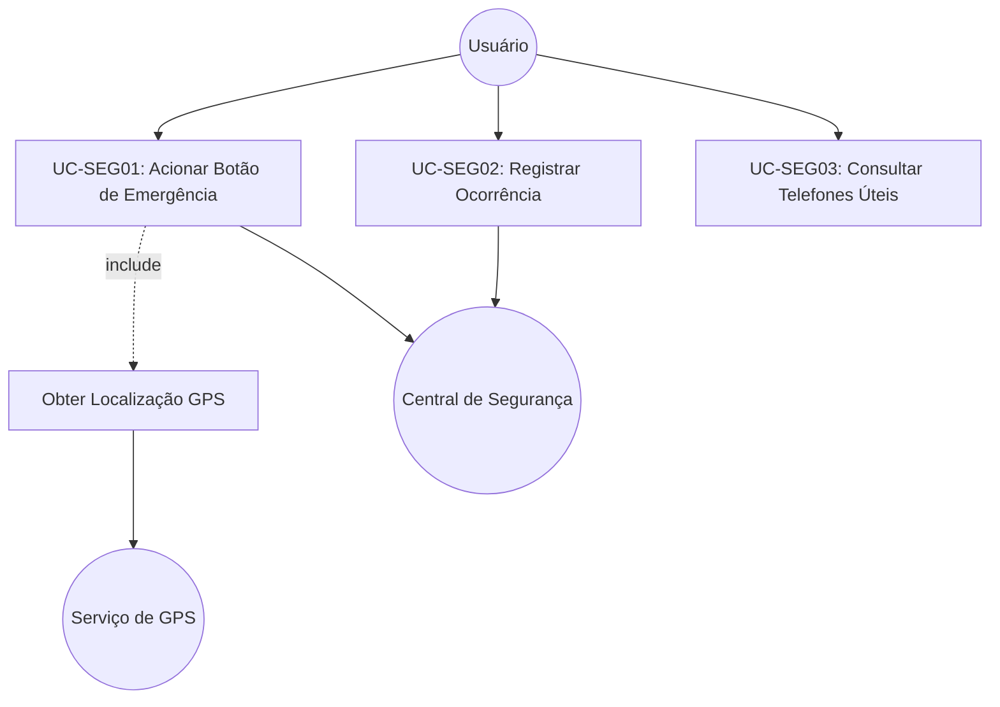

---

## 2. Perspectiva Estrutural (Informações)

### 2.1 Modelo Conceitual de Classes de Domínio (Proposta Inicial)
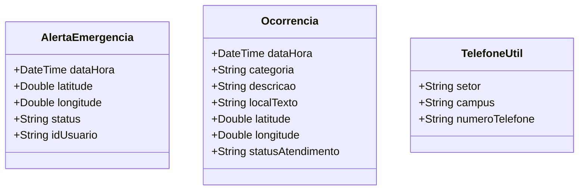

---

## 3. Diretrizes para o Autor e Revisor
- [ ] O autor deve verificar se o fluxo do caso de uso do botão de emergência atende aos requisitos levantados na eliciação.
- [ ] O revisor deve inspecionar a consistência dos atributos das classes de domínio em relação aos dados exigidos pelas ocorrências reais.

## 4. Referências Bibliográficas
- [SWEBOK, 2024] Software Requirements - Analysis Fundamentals.
- [ISO/IEC/IEEE, 2018] 29148:2018 - Systems and software engineering.


---


# [ANA-MOD2] Análise de Requisitos — Módulo 2: Rádio UFG

- **Módulo:** Módulo 2 — Rádio UFG
- **Seção:** 02-Análise
- **Autor(a):** 
- **Revisor(a):** 
- **Data de Elaboração:** 2026-10-19
- **Data da Última Revisão:** [Aguardando Revisão]
- **Status do Artefato:** [Em Elaboração / Proposta Inicial de Modelagem]
- **Uso de IA:** [Registrar em apendices/registro-ia/prompts-e-ferramentas.md caso utilize IA]

---

## 1. Perspectiva Comportamental (Interações)

### 1.1 Atores Identificados (Proposta)
- **Ouvinte (Usuário Final):** Interage com o player, consulta horários e seleciona conteúdos.
- **Servidor de Streaming da Rádio:** Fornece o fluxo contínuo de áudio pela rede.
- **Gerenciador de Mídia do SO:** Sistema operacional do smartphone que gerencia notificações de mídia e execução em segundo plano.

### 1.2 Casos de Uso Identificados
- **UC-RAD01: Reproduzir Streaming ao Vivo**
  - *Fluxo Básico:* O usuário clica no botão reproduzir; o app conecta ao fluxo de streaming da 108,5 FM e inicia a reprodução do áudio.
- **UC-RAD02: Consultar Grade Semanal de Programação**
  - *Fluxo Básico:* O usuário visualiza os programas e faixas de horário do dia selecionado.
- **UC-RAD03: Reproduzir Podcasts / Áudios Gravados**
  - *Fluxo Básico:* O usuário pesquisa ou navega pela lista de episódios gravados e aciona a reprodução com controle de progresso.

---

## 2. Perspectiva Estrutural (Informações)

### 2.1 Modelo Conceitual de Classes de Domínio (Proposta Inicial)
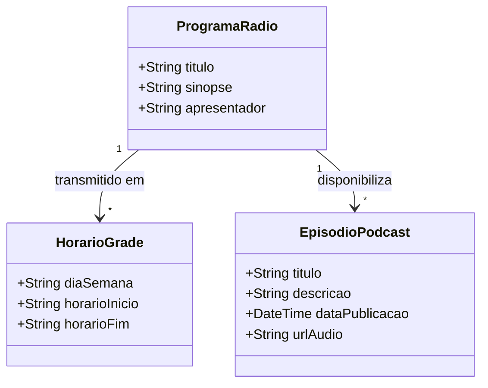

---

## 3. Diretrizes para o Autor e Revisor
- [ ] O autor deve validar a viabilidade do streaming em segundo plano e os campos da grade com a equipe da rádio.
- [ ] O revisor deve verificar se os fluxos de áudio gravado e ao vivo estão adequadamente modelados.

## 4. Referências Bibliográficas
- [SWEBOK, 2024] e [ISO/IEC/IEEE, 2018] 29148:2018.


---


# [ANA-MOD3] Análise de Requisitos — Módulo 3: Guia Estudantil

- **Módulo:** Módulo 3 — Guia Estudantil
- **Seção:** 02-Análise
- **Autor(a):** 
- **Revisor(a):** 
- **Data de Elaboração:** 2026-10-19
- **Data da Última Revisão:** [Aguardando Revisão]
- **Status do Artefato:** [Em Elaboração / Proposta Inicial de Modelagem]
- **Uso de IA:** [Registrar em apendices/registro-ia/prompts-e-ferramentas.md caso utilize IA]

---

## 1. Perspectiva Comportamental (Interações)

### 1.1 Atores Identificados (Proposta)
- **Discente:** Usuário que consulta regulamentos, procedimentos e prazos do calendário acadêmico.
- **Sistemas Acadêmicos UFG:** Fonte de dados de normas e datas do calendário.

### 1.2 Casos de Uso Identificados
- **UC-GUI01: Consultar Calendário Acadêmico Oficial**
- **UC-GUI02: Consultar Procedimentos da Vida Acadêmica**
- **UC-GUI03: Consultar Diretório de Contatos Institucionais**

---

## 2. Perspectiva Estrutural (Informações)

### 2.1 Modelo Conceitual de Classes de Domínio (Proposta Inicial)
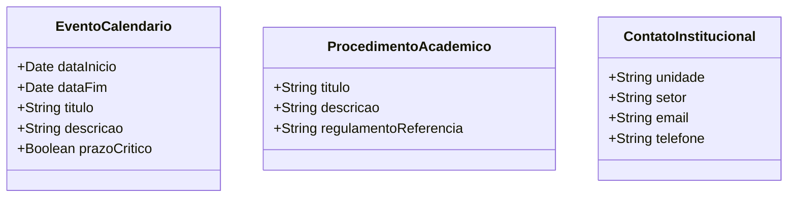

---

## 3. Diretrizes para o Autor e Revisor
- [ ] O autor deve checar quais procedimentos acadêmicos são mais procurados (ex: trancamento, quebra de pré-requisito).
- [ ] O revisor deve validar a clareza e hierarquia das entidades de procedimentos e contatos.

## 4. Referências Bibliográficas
- Regulamento Geral dos Cursos de Graduação (RGCG - UFG).
- [ISO/IEC/IEEE, 2018] 29148:2018.


---


# [ANA-MOD4] Análise de Requisitos — Módulo 4: Eventos

- **Módulo:** Módulo 4 — Eventos
- **Seção:** 02-Análise
- **Autor(a):** 
- **Revisor(a):** 
- **Data de Elaboração:** 2026-10-19
- **Data da Última Revisão:** [Aguardando Revisão]
- **Status do Artefato:** [Em Elaboração / Proposta Inicial de Modelagem]
- **Uso de IA:** [Registrar em apendices/registro-ia/prompts-e-ferramentas.md caso utilize IA]

---

## 1. Perspectiva Comportamental (Interações)

### 1.1 Atores Identificados (Proposta)
- **Usuário Discente/Docente:** Consulta a programação, filtra por datas e favorita eventos.
- **Serviço de Alertas / Calendário:** Gerencia os lembretes locais programados para o evento.

### 1.2 Casos de Uso Identificados
- **UC-EVE01: Consultar Agenda de Eventos da UFG**
- **UC-EVE02: Filtrar Eventos por Câmpus e Data**
- **UC-EVE03: Favoritar Evento e Configurar Lembretes**
- **UC-EVE04: Acessar Inscrição do Evento**

---

## 2. Perspectiva Estrutural (Informações)

### 2.1 Modelo Conceitual de Classes de Domínio (Proposta Inicial)
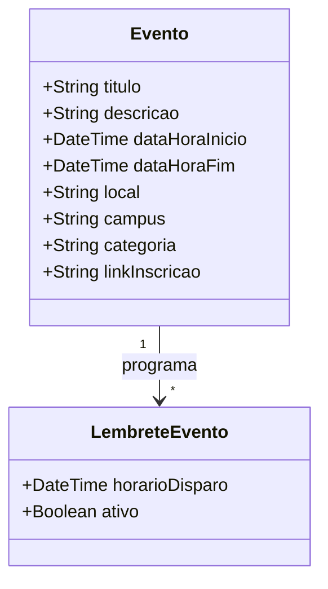

---

## 3. Diretrizes para o Autor e Revisor
- [ ] O autor deve mapear se os eventos são cadastrados localmente ou importados do portal institucional da UFG.
- [ ] O revisor deve validar a completude dos filtros previstos na definição (por regional e por data).

## 4. Referências Bibliográficas
- [SWEBOK, 2024] e [ISO/IEC/IEEE, 2018] 29148:2018.


---


# [ANA-MOD5] Análise de Requisitos — Módulo 5: Notícias

- **Módulo:** Módulo 5 — Notícias
- **Seção:** 02-Análise
- **Autor(a):** 
- **Revisor(a):** 
- **Data de Elaboração:** 2026-10-19
- **Data da Última Revisão:** [Aguardando Revisão]
- **Status do Artefato:** [Em Elaboração / Proposta Inicial de Modelagem]
- **Uso de IA:** [Registrar em apendices/registro-ia/prompts-e-ferramentas.md caso utilize IA]

---

## 1. Perspectiva Comportamental (Interações)

### 1.1 Atores Identificados (Proposta)
- **Leitor da Comunidade:** Navega pelas notícias, filtra por unidade/regional e busca por texto.
- **Serviço de Notícias UFG:** Fornece as matérias institucionais publicadas.
- **Serviço de Notificações:** Entrega avisos sobre comunicados oficiais urgentes.

### 1.2 Casos de Uso Identificados
- **UC-NOT01: Visualizar Feed de Notícias**
- **UC-NOT02: Filtrar Notícias por Regional / Unidade**
- **UC-NOT03: Pesquisar Notícias por Palavras-Chave**
- **UC-NOT04: Receber Alertas de Comunicados Oficiais**

---

## 2. Perspectiva Estrutural (Informações)

### 2.1 Modelo Conceitual de Classes de Domínio (Proposta Inicial)
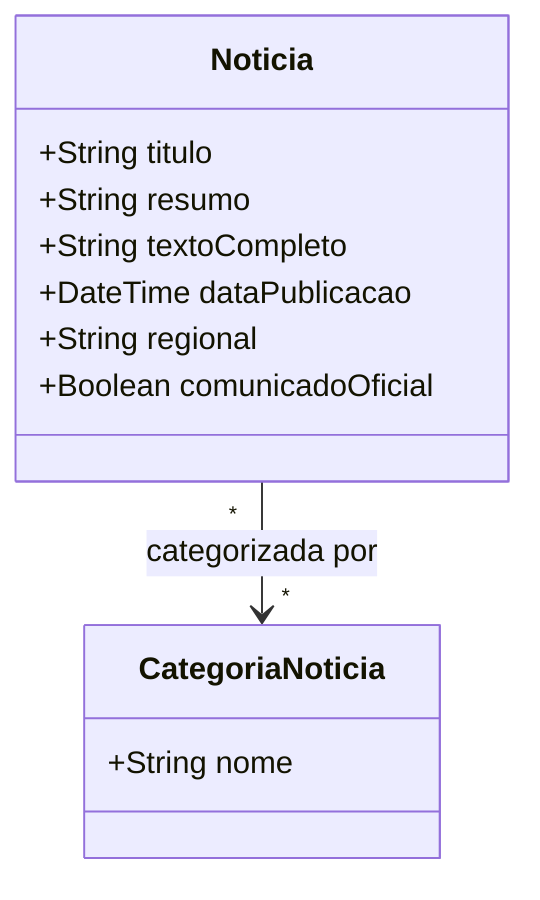

---

## 3. Diretrizes para o Autor e Revisor
- [ ] O autor deve mapear se os comunicados oficiais devem ter destaque visual fixo no topo do feed.
- [ ] O revisor deve verificar a coerência das categorias de notícias com as regionais da UFG.

## 4. Referências Bibliográficas
- [SWEBOK, 2024] e [ISO/IEC/IEEE, 2018] 29148:2018.


---


# [ANA-MOD6] Análise de Requisitos — Módulo 6: Restaurante Universitário (RU)

- **Módulo:** Módulo 6 — Restaurante Universitário (RU)
- **Seção:** 02-Análise
- **Autor(a):** 
- **Revisor(a):** 
- **Data de Elaboração:** 2026-10-19
- **Data da Última Revisão:** [Aguardando Revisão]
- **Status do Artefato:** [Em Elaboração / Proposta Inicial de Modelagem]
- **Uso de IA:** [Registrar em apendices/registro-ia/prompts-e-ferramentas.md caso utilize IA]

---

## 1. Perspectiva Comportamental (Interações)

### 1.1 Atores Identificados (Proposta)
- **Comensal (Usuário):** Consulta o cardápio e verifica saldo de créditos antes das refeições.
- **Sistema de Controle de Acesso/Créditos do RU:** Fonte de dados sobre saldo de refeições.
- **Setor de Nutrição / PRAE:** Responsável pela alimentação dos cardápios e comunicados do RU.

### 1.2 Casos de Uso Identificados
- **UC-RU01: Consultar Cardápio do Dia e da Semana por Câmpus**
- **UC-RU02: Consultar Horários de Funcionamento das Unidades**
- **UC-RU03: Consultar Saldo de Créditos e Histórico de Refeições**
- **UC-RU04: Visualizar Avisos e Comunicados do RU**

---

## 2. Perspectiva Estrutural (Informações)

### 2.1 Modelo Conceitual de Classes de Domínio (Proposta Inicial)
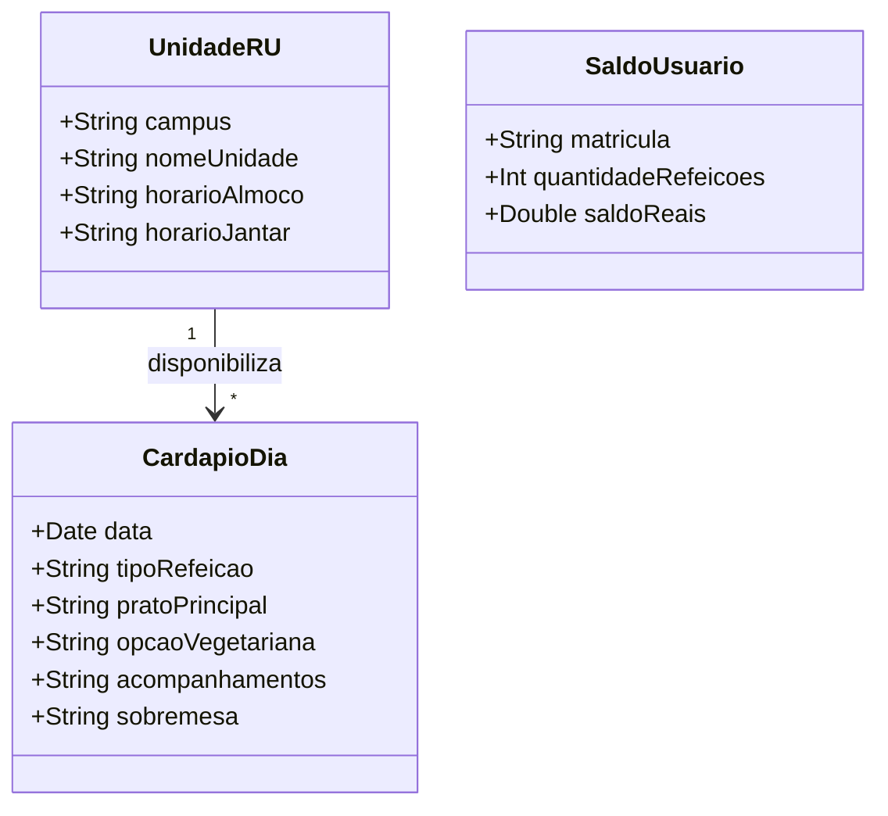

---

## 3. Diretrizes para o Autor e Revisor
- [ ] O autor deve validar a diferenciação dos cardápios entre Câmpus Samambaia (RU 1 e 2), Colemar e Câmpus Goiás.
- [ ] O revisor deve validar a precisão dos horários e regras de exibição do saldo.

## 4. Referências Bibliográficas
- [SWEBOK, 2024] e [ISO/IEC/IEEE, 2018] 29148:2018.
- Normas de Funcionamento do RU - PRAE/UFG.


---


# [ANA-MOD7] Análise de Requisitos — Módulo 7: Locais e Navegação

- **Módulo:** Módulo 7 — Locais
- **Seção:** 02-Análise
- **Autor(a):** 
- **Revisor(a):** 
- **Data de Elaboração:** 2026-10-19
- **Data da Última Revisão:** [Aguardando Revisão]
- **Status do Artefato:** [Em Elaboração / Proposta Inicial de Modelagem]
- **Uso de IA:** [Registrar em apendices/registro-ia/prompts-e-ferramentas.md caso utilize IA]

---

## 1. Perspectiva Comportamental (Interações)

### 1.1 Atores Identificados (Proposta)
- **Usuário:** Interage com o mapa interativo, busca prédios e traça rotas nos câmpus.
- **Serviço de Cartografia e Rotas:** Sistema que provê visualização de mapa e cálculo de caminhos.
- **Sensor de GPS:** Provedor da posição em tempo real do usuário.

### 1.2 Casos de Uso Identificados
- **UC-LOC01: Visualizar Mapa Interativo dos Câmpus**
- **UC-LOC02: Buscar Prédios, Faculdades e Laboratórios**
- **UC-LOC03: Traçar Rotas de Navegação Interna**
- **UC-LOC04: Visualizar Pontos de Interesse (POIs)**

---

## 2. Perspectiva Estrutural (Informações)

### 2.1 Modelo Conceitual de Classes de Domínio (Proposta Inicial)
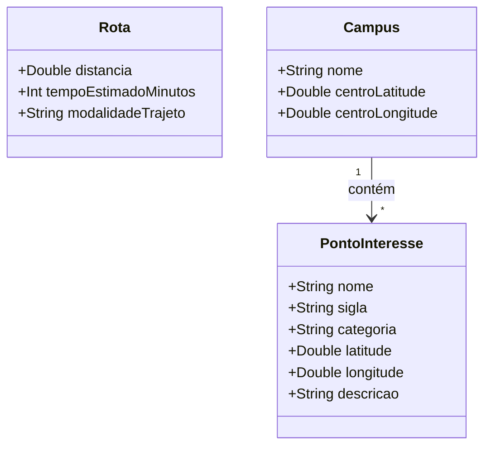

---

## 3. Diretrizes para o Autor e Revisor
- [ ] O autor deve mapear as siglas mais usuais (ex: INF, IME, CAB, CAA, Reitoria, BS) para garantir que a busca funcione pelo vocabulário dos discentes.
- [ ] O revisor deve inspecionar a modelagem das rotas e a viabilidade dos pontos de interesse.

## 4. Referências Bibliográficas
- [SWEBOK, 2024] e [ISO/IEC/IEEE, 2018] 29148:2018.


---


# [ANA-MOD8] Análise de Requisitos — Módulo 8: Apps UFG

- **Módulo:** Módulo 8 — Apps UFG
- **Seção:** 02-Análise
- **Autor(a):** 
- **Revisor(a):** 
- **Data de Elaboração:** 2026-10-19
- **Data da Última Revisão:** [Aguardando Revisão]
- **Status do Artefato:** [Em Elaboração / Proposta Inicial de Modelagem]
- **Uso de IA:** [Registrar em apendices/registro-ia/prompts-e-ferramentas.md caso utilize IA]

---

## 1. Perspectiva Comportamental (Interações)

### 1.1 Atores Identificados (Proposta)
- **Usuário da Comunidade:** Navega pelo catálogo institucional e seleciona um serviço ou app.
- **Sistema Operacional do Dispositivo:** Detecta se o aplicativo já está instalado no aparelho.
- **Lojas Oficiais de Aplicativos (Google Play / Apple Store):** Plataformas para download e instalação.

### 1.2 Casos de Uso Identificados
- **UC-APP01: Listar Catálogo de Aplicativos da UFG**
- **UC-APP02: Abrir Aplicativo Instalado no Aparelho**
- **UC-APP03: Redirecionar para Loja Oficial para Instalação**
- **UC-APP04: Redirecionar para Versão Web Institucional**

---

## 2. Perspectiva Estrutural (Informações)

### 2.1 Modelo Conceitual de Classes de Domínio (Proposta Inicial)
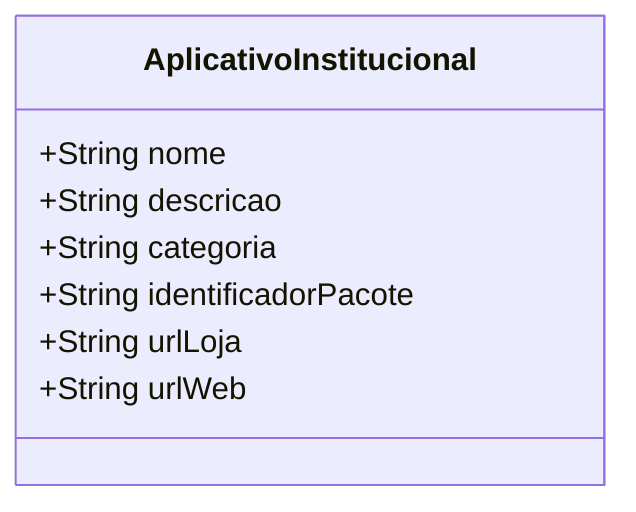

---

## 3. Diretrizes para o Autor e Revisor
- [ ] O autor deve mapear a lista completa de aplicativos oficiais mantidos pela SeTI/UFG (ex: SIGAA Mobile, SABI/Biblioteca, etc.).
- [ ] O revisor deve validar a viabilidade de verificação de pacotes instalados em Android e iOS.

## 4. Referências Bibliográficas
- [SWEBOK, 2024] e [ISO/IEC/IEEE, 2018] 29148:2018.


---


# [ANA-MOD9] Análise de Requisitos — Módulo 9: Evolução (Avaliação de Unidades Acadêmicas)

- **Módulo:** Módulo 9 — Evolução: Avaliação de Unidades Acadêmicas (UAs)
- **Seção:** 02-Análise
- **Autor(a):** 
- **Revisor(a):** 
- **Data de Elaboração:** 2026-10-19
- **Data da Última Revisão:** [Aguardando Revisão]
- **Status do Artefato:** [Em Elaboração / Proposta Baseada no Apêndice A]
- **Uso de IA:** [Registrar em apendices/registro-ia/prompts-e-ferramentas.md caso utilize IA]

---

## 1. Perspectiva Comportamental (Interações)

### 1.1 Atores Identificados
- **Membro da Comunidade Acadêmica (Avaliador):** Discente, docente ou servidor que preenche e envia as notas de avaliação de uma UA.
- **Consultor da Comunidade:** Usuário que acessa as notas individuais, por área do CNPq ou a média geral da UFG.
- **Sistema de Processamento Estatístico:** Módulo que recalcula as médias aritméticas a cada submissão.

### 1.2 Casos de Uso Identificados (Conforme Apêndice A)
- **UC-AVA01: Avaliar Qualidade de Unidade Acadêmica**
  - *Fluxo Principal:*
    1. O usuário seleciona a Unidade Acadêmica (UA).
    2. O app apresenta o formulário com as dimensões de qualidade e seus respectivos elementos educacionais.
    3. O usuário atribui nota de 0 a 5 para cada questão.
    4. O usuário confirma o envio.
    5. O sistema registra a avaliação e atualiza as médias correspondentes.
- **UC-AVA02: Consultar Avaliação por Unidade Acadêmica Individual**
- **UC-AVA03: Consultar Avaliação Média por Grande Área do Conhecimento (CNPq)**
- **UC-AVA04: Consultar Avaliação Geral da UFG (Média Global de todas as UAs)**

### 1.3 Diagrama de Atividades: Processamento das Médias (Regra Oficial do Apêndice A)
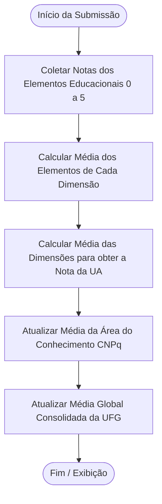

---

## 2. Perspectiva Estrutural (Informações)

### 2.1 Modelo Conceitual de Classes de Domínio
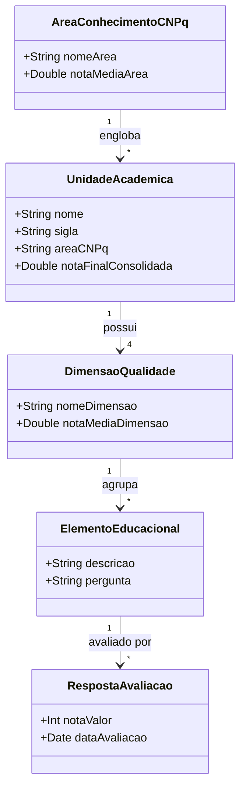

---

## 3. Regras de Negócio Oficiais (Extraídas do Apêndice A)
- **RN-AVA01 (Escala de Notas):** Cada questão sobre elemento educacional deve receber nota inteira entre 0 (péssima) e 5 (excelente).
- **RN-AVA02 (Nota da Dimensão):** A média simples das notas dos elementos educacionais determina a nota da dimensão de qualidade.
- **RN-AVA03 (Nota da UA):** A média simples das notas das dimensões de qualidade determina a nota final da Unidade Acadêmica.
- **RN-AVA04 (Média por Área CNPq):** Média aritmética das notas finais de todas as UAs pertencentes à mesma grande área do CNPq.
- **RN-AVA05 (Média Global UFG):** Média aritmética das notas finais de todas as UAs da universidade.

## 4. Referências Bibliográficas
- Apêndice A da APS - INF0339 (2026/2).
- Tabela de Áreas do Conhecimento do CNPq.
- [SWEBOK, 2024] e [ISO/IEC/IEEE, 2018] 29148:2018.


---


ewpage


# Seção 3 — Especificação de Requisitos

A especificação de requisitos transforma a visão e modelos conceituais em declarações formais, precisas, testáveis e inequívocas de requisitos de software, em total conformidade com a norma **ISO/IEC/IEEE 29148:2018** e o **SWEBOK v4**.

---

## Objetivos desta Seção
1. **Requisitos Funcionais (RF):** Descrever o que o software deve fazer, com entradas, saídas e comportamentos sob condições operacionais normais e anômalas.
2. **Requisitos Não-Funcionais / Requisitos de Qualidade (RNF):** Definir atributos de qualidade essenciais com métricas quantificáveis e verificáveis:
   - Desempenho e tempo de resposta
   - Usabilidade e Acessibilidade (WCAG 2.1 / e-MAG)
   - Segurança e Privacidade (LGPD)
   - Confiabilidade e Tolerância a Falhas
   - Portabilidade (Android e iOS)
3. **Regras de Negócio (RN):** Condições, cálculos, restrições legais e políticas operacionais que regem o comportamento das funções.
4. **Priorização de Requisitos:** Aplicação de técnica de priorização (MoSCoW: Must have, Should have, Could have, Won't have).

---

## Padrão de Nomenclatura dos Identificadores
- `RF-MOD<N>-<XX>`: Requisito Funcional do Módulo N
- `RNF-MOD<N>-<XX>`: Requisito Não-Funcional do Módulo N
- `RN-MOD<N>-<XX>`: Regra de Negócio do Módulo N
- `US-MOD<N>-<XX>`: História de Usuário (*User Story*) do Módulo N

---

## Módulos nesta Seção
- `modulo-1-seguranca/`
- `modulo-2-radio/`
- `modulo-3-guia-estudantil/`
- `modulo-4-eventos/`
- `modulo-5-noticias/`
- `modulo-6-ru/`
- `modulo-7-locais/`
- `modulo-8-apps-ufg/`
- `modulo-9-evolucao-avaliacao-ua/`


# [ESP-MOD1] Especificação de Requisitos — Módulo 1: Segurança

- **Módulo:** Módulo 1 — Segurança
- **Seção:** 03-Especificação
- **Autor(a):** 
- **Revisor(a):** 
- **Data de Elaboração:** 2026-10-19
- **Data da Última Revisão:** [Aguardando Revisão]
- **Status do Artefato:** [Em Elaboração / Proposta de Especificação]
- **Uso de IA:** [Registrar em apendices/registro-ia/prompts-e-ferramentas.md caso utilize IA]

---

## 1. Requisitos Funcionais (RF) — Baseados no Escopo Oficial

| Identificador | Nome do Requisito | Descrição Oficial / Proposta | Prioridade Sugerida |
| :--- | :--- | :--- | :---: |
| **RF-MOD1-01** | Botão de Emergência | O sistema deve disponibilizar um botão de emergência destacado para solicitação de apoio à central de segurança da UFG. | Must Have |
| **RF-MOD1-02** | Envio de Alerta com Localização | O sistema deve capturar a localização geográfica do dispositivo (coordenadas GPS) e transmiti-la junto ao alerta para a central de segurança. | Must Have |
| **RF-MOD1-03** | Registro de Ocorrências | O sistema deve permitir que o usuário registre ocorrências acontecidas no câmpus com descrição, categoria e anexos opcionais (fotos). | Should Have |
| **RF-MOD1-04** | Acompanhamento de Ocorrências | O sistema deve permitir ao usuário consultar o status de andamento das ocorrências por ele registradas. | Should Have |
| **RF-MOD1-05** | Telefones Úteis da Vigilância | O sistema deve exibir lista de contatos e telefones úteis da segurança da UFG com suporte a discagem rápida. | Must Have |

---

## 2. Requisitos Não-Funcionais (RNF / Requisitos de Qualidade)
*Orientações para o autor definir métricas quantificáveis e mensuráveis (conforme ISO/IEC/IEEE 29148:2018):*

| Identificador | Categoria | Descrição e Métrica a Definir |
| :--- | :--- | :--- |
| **RNF-MOD1-01** | Desempenho / Tempo de Resposta | *[Definir tempo máximo aceitável para entrega do alerta de emergência na central, ex: até X segundos em rede móvel]* |
| **RNF-MOD1-02** | Confiabilidade / Tolerância a Falhas | *[Definir comportamento em caso de ausência de sinal de internet, ex: fallback para chamada direta ou SMS]* |
| **RNF-MOD1-03** | Usabilidade / Acessibilidade | *[Definir número máximo de toques para acionar o botão de emergência e critérios de contraste visual]* |
| **RNF-MOD1-04** | Segurança e Privacidade | *[Definir requisitos de criptografia em trânsito (HTTPS/TLS) e conformidade com a LGPD para dados do usuário]* |

---

## 3. Regras de Negócio (RN) — Tópicos para Definição pela Equipe
- **RN-MOD1-01 (Prevenção de Falso Positivo):** *[A equipe deve definir a regra de acionamento do botão para evitar disparos acidentais no bolso, ex: pressão contínua por X segundos ou confirmação]*
- **RN-MOD1-02 (Identificação do Usuário):** *[A equipe deve definir se o registro de ocorrência pode ser anônimo ou se exige autenticação via credenciais UFG]*

## 4. Referências Bibliográficas
- [ISO/IEC/IEEE, 2018] International Standard 29148:2018 - Requirements Specification.
- [SWEBOK, 2024] Software Engineering Body of Knowledge.


---


# [ESP-MOD2] Especificação de Requisitos — Módulo 2: Rádio UFG

- **Módulo:** Módulo 2 — Rádio UFG
- **Seção:** 03-Especificação
- **Autor(a):** 
- **Revisor(a):** 
- **Data de Elaboração:** 2026-10-19
- **Data da Última Revisão:** [Aguardando Revisão]
- **Status do Artefato:** [Em Elaboração / Proposta de Especificação]
- **Uso de IA:** [Registrar em apendices/registro-ia/prompts-e-ferramentas.md caso utilize IA]

---

## 1. Requisitos Funcionais (RF) — Baseados no Escopo Oficial

| Identificador | Nome do Requisito | Descrição Oficial / Proposta | Prioridade Sugerida |
| :--- | :--- | :--- | :---: |
| **RF-MOD2-01** | Player de Streaming ao Vivo | O aplicativo deve reproduzir o sinal de streaming ao vivo da Rádio UFG 108,5 FM. | Must Have |
| **RF-MOD2-02** | Controles de Reprodução | O aplicativo deve fornecer controles para iniciar (Play), pausar (Pause) e ajustar o volume da transmissão. | Must Have |
| **RF-MOD2-03** | Grade de Programação Semanal | O sistema deve exibir a grade de programação organizada com os horários e nomes dos programas transmitidos. | Should Have |
| **RF-MOD2-04** | Reprodução em Segundo Plano | O áudio da rádio deve continuar em execução mesmo quando o aplicativo estiver minimizado ou com a tela bloqueada. | Must Have |
| **RF-MOD2-05** | Catálogo de Podcasts e Áudios | O aplicativo deve disponibilizar acesso a episódios de podcasts e conteúdos de áudio previamente gravados. | Could Have |

---

## 2. Requisitos Não-Funcionais (RNF / Requisitos de Qualidade)
*Orientações para o autor definir métricas quantificáveis:*

| Identificador | Categoria | Descrição e Métrica a Definir |
| :--- | :--- | :--- |
| **RNF-MOD2-01** | Desempenho / Latência | *[Definir tempo limite aceitável de buffer inicial para início do áudio, ex: X segundos]* |
| **RNF-MOD2-02** | Eficiência de Recursos / Bateria | *[Definir parâmetros de consumo de bateria e de franquia de dados móveis]* |
| **RNF-MOD2-03** | Usabilidade de Mídia | *[Definir disponibilidade de controles na barra de notificações e tela de bloqueio do sistema operacional]* |

---

## 3. Regras de Negócio (RN) — Tópicos para Definição pela Equipe
- **RN-MOD2-01 (Comportamento durante Chamadas/Áudio Externo):** *[Definir se a rádio pausa automaticamente quando o telefone toca ou outro aplicativo reproduz som]*

## 4. Referências Bibliográficas
- [ISO/IEC/IEEE, 2018] 29148:2018.
- [SWEBOK, 2024] Software Engineering Body of Knowledge.


---


# [ESP-MOD3] Especificação de Requisitos — Módulo 3: Guia Estudantil

- **Módulo:** Módulo 3 — Guia Estudantil
- **Seção:** 03-Especificação
- **Autor(a):** 
- **Revisor(a):** 
- **Data de Elaboração:** 2026-10-19
- **Data da Última Revisão:** [Aguardando Revisão]
- **Status do Artefato:** [Em Elaboração / Proposta de Especificação]
- **Uso de IA:** [Registrar em apendices/registro-ia/prompts-e-ferramentas.md caso utilize IA]

---

## 1. Requisitos Funcionais (RF) — Baseados no Escopo Oficial

| Identificador | Nome do Requisito | Descrição Oficial / Proposta | Prioridade Sugerida |
| :--- | :--- | :--- | :---: |
| **RF-MOD3-01** | Calendário Acadêmico | O sistema deve exibir as datas, prazos e eventos do calendário acadêmico oficial da UFG. | Must Have |
| **RF-MOD3-02** | Consulta de Regimentos e Normas | O sistema deve fornecer textos explicativos sobre regimentos e normas da vida universitária. | Must Have |
| **RF-MOD3-03** | Procedimentos Acadêmicos | O sistema deve orientar os estudantes sobre o passo a passo para a realização de procedimentos acadêmicos (matrícula, trancamento, etc.). | Must Have |
| **RF-MOD3-04** | Contatos Institucionais | O sistema deve listar contatos oficiais (e-mails, telefones, locais) de pró-reitorias, coordenações e secretarias. | Should Have |

---

## 2. Requisitos Não-Funcionais (RNF / Requisitos de Qualidade)
*Orientações para o autor definir métricas quantificáveis:*

| Identificador | Categoria | Descrição e Métrica a Definir |
| :--- | :--- | :--- |
| **RNF-MOD3-01** | Disponibilidade Offline | *[Definir se o calendário acadêmico deve ser armazenado localmente para consulta sem sinal de rede]* |
| **RNF-MOD3-02** | Usabilidade / Legibilidade | *[Definir padrões de tipografia e busca rápida por palavras-chave nos manuais acadêmicos]* |

---

## 3. Regras de Negócio (RN) — Tópicos para Definição pela Equipe
- **RN-MOD3-01 (Sincronização de Alterações):** *[Definir como o aplicativo deve refletir alterações no calendário acadêmico aprovadas pelo conselho universitário]*

## 4. Referências Bibliográficas
- Regulamento Geral dos Cursos de Graduação (RGCG - UFG).
- [ISO/IEC/IEEE, 2018] 29148:2018.


---


# [ESP-MOD4] Especificação de Requisitos — Módulo 4: Eventos

- **Módulo:** Módulo 4 — Eventos
- **Seção:** 03-Especificação
- **Autor(a):** 
- **Revisor(a):** 
- **Data de Elaboração:** 2026-10-19
- **Data da Última Revisão:** [Aguardando Revisão]
- **Status do Artefato:** [Em Elaboração / Proposta de Especificação]
- **Uso de IA:** [Registrar em apendices/registro-ia/prompts-e-ferramentas.md caso utilize IA]

---

## 1. Requisitos Funcionais (RF) — Baseados no Escopo Oficial

| Identificador | Nome do Requisito | Descrição Oficial / Proposta | Prioridade Sugerida |
| :--- | :--- | :--- | :---: |
| **RF-MOD4-01** | Agenda de Eventos | O aplicativo deve exibir a agenda de eventos acadêmicos, culturais e esportivos da UFG. | Must Have |
| **RF-MOD4-02** | Filtragem por Regional e Data | O aplicativo deve permitir explorar eventos aplicando filtros por regional/câmpus e por data. | Must Have |
| **RF-MOD4-03** | Favoritar Eventos | O aplicativo deve permitir ao usuário marcar eventos como favoritos para consulta posterior. | Should Have |
| **RF-MOD4-04** | Lembretes de Eventos | O aplicativo deve possibilitar a configuração e o disparo de lembretes para os eventos favoritados. | Should Have |
| **RF-MOD4-05** | Inscrição em Eventos | O aplicativo deve oferecer caminho ou integração para que o usuário realize sua inscrição no evento. | Should Have |

---

## 2. Requisitos Não-Funcionais (RNF / Requisitos de Qualidade)
*Orientações para o autor definir métricas quantificáveis:*

| Identificador | Categoria | Descrição e Métrica a Definir |
| :--- | :--- | :--- |
| **RNF-MOD4-01** | Integração de Calendário | *[Definir se o app deve permitir exportar eventos para o calendário nativo do smartphone]* |
| **RNF-MOD4-02** | Desempenho de Carga | *[Definir tempo máximo para carregar e filtrar a lista de eventos sob rede móvel]* |

---

## 3. Regras de Negócio (RN) — Tópicos para Definição pela Equipe
- **RN-MOD4-01 (Eventos Passados):** *[Definir como o sistema trata eventos cuja data de realização já expirou]*

## 4. Referências Bibliográficas
- [ISO/IEC/IEEE, 2018] 29148:2018.


---


# [ESP-MOD5] Especificação de Requisitos — Módulo 5: Notícias

- **Módulo:** Módulo 5 — Notícias
- **Seção:** 03-Especificação
- **Autor(a):** 
- **Revisor(a):** 
- **Data de Elaboração:** 2026-10-19
- **Data da Última Revisão:** [Aguardando Revisão]
- **Status do Artefato:** [Em Elaboração / Proposta de Especificação]
- **Uso de IA:** [Registrar em apendices/registro-ia/prompts-e-ferramentas.md caso utilize IA]

---

## 1. Requisitos Funcionais (RF) — Baseados no Escopo Oficial

| Identificador | Nome do Requisito | Descrição Oficial / Proposta | Prioridade Sugerida |
| :--- | :--- | :--- | :---: |
| **RF-MOD5-01** | Feed de Notícias | O aplicativo deve apresentar um feed atualizado com as notícias da UFG. | Must Have |
| **RF-MOD5-02** | Filtragem por Regional/Unidade | O usuário deve poder filtrar as notícias exibidas por regional e por unidade da UFG. | Must Have |
| **RF-MOD5-03** | Notificações de Comunicados Oficiais | O aplicativo deve enviar notificações e dar destaque aos comunicados oficiais da universidade. | Must Have |
| **RF-MOD5-04** | Pesquisa por Notícias | O aplicativo deve oferecer mecanismo de busca textual para encontrar notícias publicadas. | Should Have |

---

## 2. Requisitos Não-Funcionais (RNF / Requisitos de Qualidade)
*Orientações para o autor definir métricas quantificáveis:*

| Identificador | Categoria | Descrição e Métrica a Definir |
| :--- | :--- | :--- |
| **RNF-MOD5-01** | Desempenho / Tempo de Resposta | *[Definir tempo máximo de carregamento da primeira página do feed]* |
| **RNF-MOD5-02** | Consumo de Dados / Cache | *[Definir estratégia de cache e compressão de imagens para economizar pacote de dados]* |

---

## 3. Regras de Negócio (RN) — Tópicos para Definição pela Equipe
- **RN-MOD5-01 (Ordenação e Destaque):** *[Definir a ordem de exibição das notícias no feed e regras para fixação de comunicados urgentes]*

## 4. Referências Bibliográficas
- [ISO/IEC/IEEE, 2018] 29148:2018.


---


# [ESP-MOD6] Especificação de Requisitos — Módulo 6: Restaurante Universitário (RU)

- **Módulo:** Módulo 6 — Restaurante Universitário (RU)
- **Seção:** 03-Especificação
- **Autor(a):** 
- **Revisor(a):** 
- **Data de Elaboração:** 2026-10-19
- **Data da Última Revisão:** [Aguardando Revisão]
- **Status do Artefato:** [Em Elaboração / Proposta de Especificação]
- **Uso de IA:** [Registrar em apendices/registro-ia/prompts-e-ferramentas.md caso utilize IA]

---

## 1. Requisitos Funcionais (RF) — Baseados no Escopo Oficial

| Identificador | Nome do Requisito | Descrição Oficial / Proposta | Prioridade Sugerida |
| :--- | :--- | :--- | :---: |
| **RF-MOD6-01** | Cardápio do Dia e da Semana | O sistema deve disponibilizar o cardápio diário e semanal com os componentes de cada refeição (almoço e jantar). | Must Have |
| **RF-MOD6-02** | Filtragem por Câmpus | O sistema deve permitir visualizar o cardápio específico do câmpus selecionado (Samambaia, Colemar, Goiás, etc.). | Must Have |
| **RF-MOD6-03** | Horários de Funcionamento | O sistema deve exibir os horários oficiais de atendimento de cada unidade do RU. | Must Have |
| **RF-MOD6-04** | Aviso de Saldo e Créditos | O sistema deve permitir consultar o saldo e emitir avisos sobre a quantidade de créditos disponíveis para o estudante. | Should Have |
| **RF-MOD6-05** | Avisos do RU | O sistema deve exibir comunicados, avisos e notas da equipe do RU aos comensais. | Should Have |

---

## 2. Requisitos Não-Funcionais (RNF / Requisitos de Qualidade)
*Orientações para o autor definir métricas quantificáveis:*

| Identificador | Categoria | Descrição e Métrica a Definir |
| :--- | :--- | :--- |
| **RNF-MOD6-01** | Acessibilidade Visual | *[Definir padrões de identificação e contraste para alergênicos e pratos vegetarianos]* |
| **RNF-MOD6-02** | Disponibilidade e Cache | *[Definir tempo de retenção do cardápio em cache para acesso offline]* |

---

## 3. Regras de Negócio (RN) — Tópicos para Definição pela Equipe
- **RN-MOD6-01 (Alternância de Refeições):** *[Definir como e quando a tela do cardápio transiciona entre almoço e jantar]*
- **RN-MOD6-02 (Aviso de Saldo Mínimo):** *[Definir a partir de quantas refeições restantes o app deve disparar aviso de saldo baixo]*

## 4. Referências Bibliográficas
- [ISO/IEC/IEEE, 2018] 29148:2018.
- Regulamento do RU - PRAE/UFG.


---


# [ESP-MOD7] Especificação de Requisitos — Módulo 7: Locais e Navegação

- **Módulo:** Módulo 7 — Locais
- **Seção:** 03-Especificação
- **Autor(a):** 
- **Revisor(a):** 
- **Data de Elaboração:** 2026-10-19
- **Data da Última Revisão:** [Aguardando Revisão]
- **Status do Artefato:** [Em Elaboração / Proposta de Especificação]
- **Uso de IA:** [Registrar em apendices/registro-ia/prompts-e-ferramentas.md caso utilize IA]

---

## 1. Requisitos Funcionais (RF) — Baseados no Escopo Oficial

| Identificador | Nome do Requisito | Descrição Oficial / Proposta | Prioridade Sugerida |
| :--- | :--- | :--- | :---: |
| **RF-MOD7-01** | Mapa Interativo dos Câmpus | O sistema deve disponibilizar um mapa digital e interativo abrangendo as unidades e câmpus da UFG. | Must Have |
| **RF-MOD7-02** | Busca de Locais | O usuário deve poder buscar prédios, faculdades, institutos, centros de aulas e laboratórios por nome ou sigla. | Must Have |
| **RF-MOD7-03** | Criação de Rotas | O sistema deve calcular e traçar rotas de navegação da posição do usuário até o ponto de destino desejado. | Should Have |
| **RF-MOD7-04** | Pontos de Interesse (POIs) | O sistema deve exibir pontos de interesse no mapa (paradas de ônibus, caixas eletrônicos, bebedouros, etc.). | Should Have |

---

## 2. Requisitos Não-Funcionais (RNF / Requisitos de Qualidade)
*Orientações para o autor definir métricas quantificáveis:*

| Identificador | Categoria | Descrição e Métrica a Definir |
| :--- | :--- | :--- |
| **RNF-MOD7-01** | Desempenho / Fluidez do Mapa | *[Definir taxa de quadros (FPS) ou tempo de carregamento dos blocos de mapa]* |
| **RNF-MOD7-02** | Precisão de Navegação | *[Definir margem de erro aceitável para o posicionamento e rotas]* |
| **RNF-MOD7-03** | Acessibilidade | *[Definir suporte a rotas acessíveis para pessoas com deficiência ou mobilidade reduzida]* |

---

## 3. Regras de Negócio (RN) — Tópicos para Definição pela Equipe
- **RN-MOD7-01 (Cobertura Geográfica):** *[Definir se o mapa abre centralizado no câmpus mais próximo do usuário ou por seleção prévia]*

## 4. Referências Bibliográficas
- [ISO/IEC/IEEE, 2018] 29148:2018.
- Diretrizes de Acessibilidade Territorial da UFG.


---


# [ESP-MOD8] Especificação de Requisitos — Módulo 8: Apps UFG

- **Módulo:** Módulo 8 — Apps UFG
- **Seção:** 03-Especificação
- **Autor(a):** 
- **Revisor(a):** 
- **Data de Elaboração:** 2026-10-19
- **Data da Última Revisão:** [Aguardando Revisão]
- **Status do Artefato:** [Em Elaboração / Proposta de Especificação]
- **Uso de IA:** [Registrar em apendices/registro-ia/prompts-e-ferramentas.md caso utilize IA]

---

## 1. Requisitos Funcionais (RF) — Baseados no Escopo Oficial

| Identificador | Nome do Requisito | Descrição Oficial / Proposta | Prioridade Sugerida |
| :--- | :--- | :--- | :---: |
| **RF-MOD8-01** | Catálogo de Apps e Sistemas UFG | O sistema deve listar os aplicativos e serviços digitais da UFG com descrição de finalidade e público-alvo. | Must Have |
| **RF-MOD8-02** | Abertura Direta de App Instalado | O sistema deve permitir abrir o aplicativo satélite diretamente caso já esteja instalado no dispositivo. | Must Have |
| **RF-MOD8-03** | Direcionamento para Lojas Oficiais | Caso o aplicativo não esteja instalado, o sistema deve direcionar o usuário para a página de download na loja oficial (Play Store / App Store). | Must Have |
| **RF-MOD8-04** | Acesso a Sistemas Web | O sistema deve disponibilizar links institucionais de direcionamento para sistemas que funcionam via navegador (ex: Webmail, SIGAA Web). | Should Have |

---

## 2. Requisitos Não-Funcionais (RNF / Requisitos de Qualidade)
*Orientações para o autor definir métricas quantificáveis:*

| Identificador | Categoria | Descrição e Métrica a Definir |
| :--- | :--- | :--- |
| **RNF-MOD8-01** | Portabilidade e Compatibilidade | *[Definir versões mínimas de suporte para Android e iOS]* |
| **RNF-MOD8-02** | Segurança de Links | *[Definir validação estrita de domínios confiáveis (*.ufg.br) para evitar phishing]* |

---

## 3. Regras de Negócio (RN) — Tópicos para Definição pela Equipe
- **RN-MOD8-01 (Auditoria de Aplicativos):** *[Definir critérios para inclusão de novos aplicativos parceiros no catálogo institucional]*

## 4. Referências Bibliográficas
- [ISO/IEC/IEEE, 2018] 29148:2018.
- Catálogo de Serviços de TI da SeTI - UFG.


---


# [ESP-MOD9] Especificação de Requisitos — Módulo 9: Evolução (Avaliação de Unidades Acadêmicas)

- **Módulo:** Módulo 9 — Evolução: Avaliação de Unidades Acadêmicas (UAs)
- **Seção:** 03-Especificação
- **Autor(a):** 
- **Revisor(a):** 
- **Data de Elaboração:** 2026-10-19
- **Data da Última Revisão:** [Aguardando Revisão]
- **Status do Artefato:** [Em Elaboração / Proposta de Especificação]
- **Uso de IA:** [Registrar em apendices/registro-ia/prompts-e-ferramentas.md caso utilize IA]

---

## 1. Requisitos Funcionais (RF) — Baseados no Apêndice A

| Identificador | Nome do Requisito | Descrição Oficial (Apêndice A) | Prioridade |
| :--- | :--- | :--- | :---: |
| **RF-MOD9-01** | Seleção da Unidade Acadêmica | O sistema deve permitir ao usuário selecionar a Unidade Acadêmica (UA) da UFG a ser avaliada. | Must Have |
| **RF-MOD9-02** | Formulário das Dimensões de Qualidade | O sistema deve apresentar questionário contendo as 4 dimensões (infraestrutura física, corpo docente, recursos pedagógicos e condições ambientais), com questões predefinidas para cada elemento educacional. | Must Have |
| **RF-MOD9-03** | Atribuição de Notas de 0 a 5 | O sistema deve permitir atribuir notas inteiras na escala de 0 (péssima) a 5 (excelente) para as questões de cada elemento educacional. | Must Have |
| **RF-MOD9-04** | Cálculo da Nota da Dimensão | O sistema deve calcular a pontuação média dos elementos educacionais para determinar a nota da respectiva dimensão de qualidade. | Must Have |
| **RF-MOD9-05** | Cálculo da Nota Final da UA | O sistema deve calcular a média das notas das dimensões de qualidade para determinar a nota final da avaliação da UA. | Must Have |
| **RF-MOD9-06** | Exibição da Nota por UA Individual | O sistema deve disponibilizar a nota de avaliação por UA individual e os detalhes de suas dimensões. | Must Have |
| **RF-MOD9-07** | Exibição da Média por Área CNPq | O sistema deve exibir a nota média agrupada por grande área de conhecimento (conforme tabela oficial do CNPq). | Must Have |
| **RF-MOD9-08** | Exibição da Nota Geral da UFG | O sistema deve exibir a nota consolidada para a UFG como um todo (média de todas as UAs avaliadas). | Must Have |

---

## 2. Requisitos Não-Funcionais (RNF / Requisitos de Qualidade)
*Orientações para o autor definir métricas quantificáveis:*

| Identificador | Categoria | Descrição e Métrica a Definir |
| :--- | :--- | :--- |
| **RNF-MOD9-01** | Integridade e Controle de Votos | *[Definir mecanismo para evitar fraudes ou avaliações repetidas abusivas]* |
| **RNF-MOD9-02** | Privacidade e Anonimato | *[Definir garantia de sigilo da opinião individual do estudante/servidor]* |
| **RNF-MOD9-03** | Tempo de Consolidação Estatística | *[Definir tempo limite aceitável para atualização das médias consolidadas]* |

---

## 3. Regras de Negócio (RN) — Extraídas do Apêndice A
- **RN-MOD9-01 (Escala Padronizada):** Toda nota atribuída é um número inteiro no intervalo $[0, 5]$.
- **RN-MOD9-02 (Cálculo da Média da Dimensão):** Sendo $N$ o número de elementos da dimensão $D$, a nota é a média aritmética simples das notas de seus elementos:
  $$\text{Nota}(D) = \frac{1}{N} \sum_{i=1}^{N} \text{Nota}(E_i)$$
- **RN-MOD9-03 (Cálculo da Nota da UA):** A nota da UA é a média aritmética simples das notas de suas 4 dimensões de qualidade:
  $$\text{Nota}(UA) = \frac{\text{Nota}(D_{\text{infra}}) + \text{Nota}(D_{\text{docente}}) + \text{Nota}(D_{\text{pedagogico}}) + \text{Nota}(D_{\text{ambiental}})}{4}$$
- **RN-MOD9-04 (Média por Área CNPq):** Média aritmética das notas consolidadas de todas as UAs vinculadas àquela área do CNPq.
- **RN-MOD9-05 (Média Global da UFG):** Média aritmética de todas as UAs ativas avaliadas no período.

## 4. Referências Bibliográficas
- Apêndice A da Definição de APS - INF0339 (2026/2).
- Tabela de Classificação de Áreas do Conhecimento do CNPq.
- [ISO/IEC/IEEE, 2018] 29148:2018.


---


ewpage


# Seção 4 — Validação de Requisitos

A validação de requisitos assegura que os requisitos especificados descrevem fielmente as necessidades dos usuários e atendem aos rigorosos critérios de qualidade da Engenharia de Requisitos (corretude, completude, consistência, verificabilidade e ausência de ambiguidades).

---

## Objetivos desta Seção
1. **Inspeção de Requisitos (Peer Review / Fagan):** Aplicação de checklists de verificação formal por pares para cada módulo.
2. **Critérios e Testes de Aceitação (BDD / Gherkin):** Definição de cenários executáveis com a estrutura `Dado / Quando / Então` (*Given / When / Then*) para validar o comportamento esperado.
3. **Validação de Prototipação e Interface:** Verificação de usabilidade e fluxos de navegação.
4. **Verificação dos Critérios de Avaliação (Apêndice B):**
   - Conformidade e Ética
   - Completude Funcional e de Qualidade
   - Consistência Intra e Inter-modelos
   - Rastreabilidade e Essencialidade

---

## Checklist Padrão de Validação de Requisitos
Todo artefato de validação deve verificar:
- [ ] O requisito é **não-ambíguo**? Pode ser interpretado de uma única forma?
- [ ] O requisito é **testável / verificável**? Existe um procedimento concreto para atestar conformidade?
- [ ] O requisito é **necessário** para o domínio da UFG?
- [ ] O requisito é **consistente** com os demais módulos do aplicativo?
- [ ] Os requisitos de qualidade possuem **métricas quantitativas** em vez de adjetivos vagos ("rápido", "fácil")?

---

## Módulos nesta Seção
- `modulo-1-seguranca/`
- `modulo-2-radio/`
- `modulo-3-guia-estudantil/`
- `modulo-4-eventos/`
- `modulo-5-noticias/`
- `modulo-6-ru/`
- `modulo-7-locais/`
- `modulo-8-apps-ufg/`
- `modulo-9-evolucao-avaliacao-ua/`


# [VAL-MOD1] Validação de Requisitos — Módulo 1: Segurança

- **Módulo:** Módulo 1 — Segurança
- **Seção:** 04-Validação
- **Autor(a):** 
- **Revisor(a):** 
- **Data de Elaboração:** 2026-10-19
- **Data da Última Revisão:** [Aguardando Revisão do Par]
- **Status do Artefato:** [Em Validação]
- **Uso de IA:** [Registrar em apendices/registro-ia/prompts-e-ferramentas.md caso utilize IA]

---

## 1. Cenários de Aceitação Propostos (BDD / Gherkin)
*Modelos de cenários para guiar os testes e validação da funcionalidade:*

### Cenário 1: Disparo de alerta de emergência com geolocalização
```gherkin
Cenário: Envio de alerta de socorro para a Central de Segurança
  Dado que o usuário está autenticado no aplicativo Minha UFG
  E está situado nas dependências de um dos câmpus da UFG
  E concedeu permissão de acesso à localização do smartphone
  Quando ele aciona o botão de emergência
  Então o sistema deve capturar as coordenadas de latitude e longitude
  E deve transmitir o alerta para a Central de Vigilância da UFG
  E a interface deve exibir confirmação de envio e disponibilizar o número direto da vigilância
```

### Cenário 2: Prevenção de acionamentos inadvertidos
```gherkin
Cenário: Toque acidental rápido no botão de emergência
  Dado que o usuário está na tela inicial
  Quando o botão de emergência é acionado de forma não intencional
  Então o sistema deve exigir confirmação ou pressão contínua conforme a regra de negócio definida
  E o alerta NÃO deve ser disparado indevidamente
```

---

## 2. Checklist de Inspeção de Requisitos (A ser preenchido pelo Revisor)
*O revisor designado deve avaliar cada critério abaixo durante o Code Review no GitHub:*

| Critério de Qualidade | Pergunta de Verificação | Avaliação do Revisor | Parecer e Apontamentos |
| :--- | :--- | :---: | :--- |
| **Completude** | Todos os fluxos principais e exceções foram contemplados? | [ ] Aprovado <br> [ ] Ajustar | *[Preencher pelo revisor]* |
| **Verificabilidade** | Os requisitos possuem critérios objetivos de teste? | [ ] Aprovado <br> [ ] Ajustar | *[Preencher pelo revisor]* |
| **Não-ambiguidade** | O texto é claro e livre de duplas interpretações? | [ ] Aprovado <br> [ ] Ajustar | *[Preencher pelo revisor]* |
| **Consistência** | Não há conflito com os outros módulos do app? | [ ] Aprovado <br> [ ] Ajustar | *[Preencher pelo revisor]* |
| **Rastreabilidade** | Cada requisito possui vínculo com a eliciação? | [ ] Aprovado <br> [ ] Ajustar | *[Preencher pelo revisor]* |

---

## 3. Registro do Parecer Final da Revisão
- **Data da Inspeção:** ____/____/2026
- **Resultado:** [ ] Aprovado sem ressalvas | [ ] Aprovado com ajustes | [ ] Reprovado (necessita reformulação)
- **Assinatura do Revisor:** ____________________

## 4. Referências Bibliográficas
- [ISO/IEC/IEEE, 2018] 29148:2018 - Requirements Validation.
- [SWEBOK, 2024] Software Testing and Requirements Validation.


---


# [VAL-MOD2] Validação de Requisitos — Módulo 2: Rádio UFG

- **Módulo:** Módulo 2 — Rádio UFG
- **Seção:** 04-Validação
- **Autor(a):** 
- **Revisor(a):** 
- **Data de Elaboração:** 2026-10-19
- **Data da Última Revisão:** [Aguardando Revisão do Par]
- **Status do Artefato:** [Em Validação]
- **Uso de IA:** [Registrar em apendices/registro-ia/prompts-e-ferramentas.md caso utilize IA]

---

## 1. Cenários de Aceitação Propostos (BDD / Gherkin)

```gherkin
Cenário: Reprodução contínua da rádio em segundo plano
  Dado que o usuário iniciou a reprodução do streaming da Rádio UFG 108,5 FM
  Quando ele minimiza o aplicativo ou bloqueia a tela do aparelho
  Então o sinal de áudio deve permanecer em execução sem interrupção
  E os controles de mídia (pausar/retomar) devem estar disponíveis na área de notificações
```

---

## 2. Checklist de Inspeção de Requisitos (A ser preenchido pelo Revisor)
*O revisor designado deve avaliar cada critério abaixo durante o Code Review no GitHub:*

| Critério de Qualidade | Pergunta de Verificação | Avaliação do Revisor | Parecer e Apontamentos |
| :--- | :--- | :---: | :--- |
| **Completude** | O controle de segundo plano e grade semanal foram contemplados? | [ ] Aprovado <br> [ ] Ajustar | *[Preencher pelo revisor]* |
| **Verificabilidade** | Os requisitos de áudio e streaming possuem testes definidos? | [ ] Aprovado <br> [ ] Ajustar | *[Preencher pelo revisor]* |
| **Não-ambiguidade** | A descrição dos controles e formatos de áudio está clara? | [ ] Aprovado <br> [ ] Ajustar | *[Preencher pelo revisor]* |
| **Consistência** | Não há conflito com chamadas telefônicas ou notificações? | [ ] Aprovado <br> [ ] Ajustar | *[Preencher pelo revisor]* |

---

## 3. Registro do Parecer Final da Revisão
- **Data da Inspeção:** ____/____/2026
- **Resultado:** [ ] Aprovado sem ressalvas | [ ] Aprovado com ajustes | [ ] Reprovado (necessita reformulação)
- **Assinatura do Revisor:** ____________________

## 4. Referências Bibliográficas
- [ISO/IEC/IEEE, 2018] 29148:2018.
- [SWEBOK, 2024] Software Requirements Validation.


---


# [VAL-MOD3] Validação de Requisitos — Módulo 3: Guia Estudantil

- **Módulo:** Módulo 3 — Guia Estudantil
- **Seção:** 04-Validação
- **Autor(a):** 
- **Revisor(a):** 
- **Data de Elaboração:** 2026-10-19
- **Data da Última Revisão:** [Aguardando Revisão do Par]
- **Status do Artefato:** [Em Validação]
- **Uso de IA:** [Registrar em apendices/registro-ia/prompts-e-ferramentas.md caso utilize IA]

---

## 1. Cenários de Aceitação Propostos (BDD / Gherkin)

```gherkin
Cenário: Consulta ao calendário acadêmico sem conexão com a internet
  Dado que o usuário já abriu o módulo de calendário previamente conectado
  E o dispositivo se encontra sem conexão de dados (modo avião)
  Quando ele acessa a tela do Calendário Acadêmico
  Então as datas e prazos cadastrados devem ser exibidos a partir da cópia local em cache
  E deve haver indicação de que os dados são referentes à última sincronização realizada
```

---

## 2. Checklist de Inspeção de Requisitos (A ser preenchido pelo Revisor)
*O revisor designado deve avaliar cada critério abaixo durante o Code Review no GitHub:*

| Critério de Qualidade | Pergunta de Verificação | Avaliação do Revisor | Parecer e Apontamentos |
| :--- | :--- | :---: | :--- |
| **Completude** | Cobre os principais prazos previstos no RGCG/UFG? | [ ] Aprovado <br> [ ] Ajustar | *[Preencher pelo revisor]* |
| **Verificabilidade** | É possível verificar se as informações estão em conformidade com o calendário oficial? | [ ] Aprovado <br> [ ] Ajustar | *[Preencher pelo revisor]* |
| **Não-ambiguidade** | As orientações dos procedimentos acadêmicos são claras? | [ ] Aprovado <br> [ ] Ajustar | *[Preencher pelo revisor]* |

---

## 3. Registro do Parecer Final da Revisão
- **Data da Inspeção:** ____/____/2026
- **Resultado:** [ ] Aprovado sem ressalvas | [ ] Aprovado com ajustes | [ ] Reprovado (necessita reformulação)
- **Assinatura do Revisor:** ____________________

## 4. Referências Bibliográficas
- [ISO/IEC/IEEE, 2018] 29148:2018.


---


# [VAL-MOD4] Validação de Requisitos — Módulo 4: Eventos

- **Módulo:** Módulo 4 — Eventos
- **Seção:** 04-Validação
- **Autor(a):** 
- **Revisor(a):** 
- **Data de Elaboração:** 2026-10-19
- **Data da Última Revisão:** [Aguardando Revisão do Par]
- **Status do Artefato:** [Em Validação]
- **Uso de IA:** [Registrar em apendices/registro-ia/prompts-e-ferramentas.md caso utilize IA]

---

## 1. Cenários de Aceitação Propostos (BDD / Gherkin)

```gherkin
Cenário: Notificação de lembrete para evento favoritado
  Dado que o usuário marcou um evento futuro como favorito
  E ativou a opção de lembretes
  Quando o horário programado de antecedência for atingido
  Então o aplicativo deve emitir uma notificação lembrando a data, hora e local do evento
```

---

## 2. Checklist de Inspeção de Requisitos (A ser preenchido pelo Revisor)
*O revisor designado deve avaliar cada critério abaixo durante o Code Review no GitHub:*

| Critério de Qualidade | Pergunta de Verificação | Avaliação do Revisor | Parecer e Apontamentos |
| :--- | :--- | :---: | :--- |
| **Completude** | Prevê filtros por regional e data conforme a definição da atividade? | [ ] Aprovado <br> [ ] Ajustar | *[Preencher pelo revisor]* |
| **Verificabilidade** | O fluxo de lembretes e favoritos possui condições claras de teste? | [ ] Aprovado <br> [ ] Ajustar | *[Preencher pelo revisor]* |
| **Não-ambiguidade** | Os campos de descrição e inscrições de eventos estão precisos? | [ ] Aprovado <br> [ ] Ajustar | *[Preencher pelo revisor]* |

---

## 3. Registro do Parecer Final da Revisão
- **Data da Inspeção:** ____/____/2026
- **Resultado:** [ ] Aprovado sem ressalvas | [ ] Aprovado com ajustes | [ ] Reprovado (necessita reformulação)
- **Assinatura do Revisor:** ____________________

## 4. Referências Bibliográficas
- [ISO/IEC/IEEE, 2018] 29148:2018.


---


# [VAL-MOD5] Validação de Requisitos — Módulo 5: Notícias

- **Módulo:** Módulo 5 — Notícias
- **Seção:** 04-Validação
- **Autor(a):** 
- **Revisor(a):** 
- **Data de Elaboração:** 2026-10-19
- **Data da Última Revisão:** [Aguardando Revisão do Par]
- **Status do Artefato:** [Em Validação]
- **Uso de IA:** [Registrar em apendices/registro-ia/prompts-e-ferramentas.md caso utilize IA]

---

## 1. Cenários de Aceitação Propostos (BDD / Gherkin)

```gherkin
Cenário: Notificação e destaque de comunicado oficial
  Dado que um novo comunicado oficial urgente é publicado pela UFG
  Quando a notificação push é recebida no dispositivo
  Então o usuário deve ser alertado com destaque
  E ao tocar na notificação, deve ser direcionado para a visualização do comunicado na íntegra
```

---

## 2. Checklist de Inspeção de Requisitos (A ser preenchido pelo Revisor)
*O revisor designado deve avaliar cada critério abaixo durante o Code Review no GitHub:*

| Critério de Qualidade | Pergunta de Verificação | Avaliação do Revisor | Parecer e Apontamentos |
| :--- | :--- | :---: | :--- |
| **Completude** | Abrange filtragem por regional e mecanismo de busca? | [ ] Aprovado <br> [ ] Ajustar | *[Preencher pelo revisor]* |
| **Verificabilidade** | É possível testar a pesquisa por palavras-chave com critérios objetivos? | [ ] Aprovado <br> [ ] Ajustar | *[Preencher pelo revisor]* |
| **Consistência** | As categorias de notícias estão alinhadas à estrutura institucional da UFG? | [ ] Aprovado <br> [ ] Ajustar | *[Preencher pelo revisor]* |

---

## 3. Registro do Parecer Final da Revisão
- **Data da Inspeção:** ____/____/2026
- **Resultado:** [ ] Aprovado sem ressalvas | [ ] Aprovado com ajustes | [ ] Reprovado (necessita reformulação)
- **Assinatura do Revisor:** ____________________

## 4. Referências Bibliográficas
- [ISO/IEC/IEEE, 2018] 29148:2018.


---


# [VAL-MOD6] Validação de Requisitos — Módulo 6: Restaurante Universitário (RU)

- **Módulo:** Módulo 6 — Restaurante Universitário (RU)
- **Seção:** 04-Validação
- **Autor(a):** 
- **Revisor(a):** 
- **Data de Elaboração:** 2026-10-19
- **Data da Última Revisão:** [Aguardando Revisão do Par]
- **Status do Artefato:** [Em Validação]
- **Uso de IA:** [Registrar em apendices/registro-ia/prompts-e-ferramentas.md caso utilize IA]

---

## 1. Cenários de Aceitação Propostos (BDD / Gherkin)

```gherkin
Cenário: Consulta do cardápio por câmpus selecionado
  Dado que o usuário selecionou o "Câmpus Samambaia"
  Quando ele acessa a tela de cardápio do RU
  Então o sistema deve exibir os pratos previstos para o almoço e jantar do Samambaia
  E deve indicar claramente os componentes da refeição e a opção vegetariana
```

---

## 2. Checklist de Inspeção de Requisitos (A ser preenchido pelo Revisor)
*O revisor designado deve avaliar cada critério abaixo durante o Code Review no GitHub:*

| Critério de Qualidade | Pergunta de Verificação | Avaliação do Revisor | Parecer e Apontamentos |
| :--- | :--- | :---: | :--- |
| **Completude** | Contempla horários de funcionamento, cardápio semanal e aviso de saldo? | [ ] Aprovado <br> [ ] Ajustar | *[Preencher pelo revisor]* |
| **Verificabilidade** | A regra de aviso de saldo de créditos possui métrica clara para testes? | [ ] Aprovado <br> [ ] Ajustar | *[Preencher pelo revisor]* |
| **Não-ambiguidade** | A distinção entre as unidades do RU (Samambaia, Colemar, Goiás) está clara? | [ ] Aprovado <br> [ ] Ajustar | *[Preencher pelo revisor]* |

---

## 3. Registro do Parecer Final da Revisão
- **Data da Inspeção:** ____/____/2026
- **Resultado:** [ ] Aprovado sem ressalvas | [ ] Aprovado com ajustes | [ ] Reprovado (necessita reformulação)
- **Assinatura do Revisor:** ____________________

## 4. Referências Bibliográficas
- [ISO/IEC/IEEE, 2018] 29148:2018.


---


# [VAL-MOD7] Validação de Requisitos — Módulo 7: Locais e Navegação

- **Módulo:** Módulo 7 — Locais
- **Seção:** 04-Validação
- **Autor(a):** 
- **Revisor(a):** 
- **Data de Elaboração:** 2026-10-19
- **Data da Última Revisão:** [Aguardando Revisão do Par]
- **Status do Artefato:** [Em Validação]
- **Uso de IA:** [Registrar em apendices/registro-ia/prompts-e-ferramentas.md caso utilize IA]

---

## 1. Cenários de Aceitação Propostos (BDD / Gherkin)

```gherkin
Cenário: Busca de prédio e cálculo de rota no câmpus
  Dado que o usuário está navegando no mapa do Câmpus Samambaia
  Quando ele digita a sigla "INF" na barra de busca
  Então o sistema deve destacar a localização do Instituto de Informática no mapa
  E ao solicitar a rota, deve traçar o trajeto a partir do ponto atual até a entrada do prédio
```

---

## 2. Checklist de Inspeção de Requisitos (A ser preenchido pelo Revisor)
*O revisor designado deve avaliar cada critério abaixo durante o Code Review no GitHub:*

| Critério de Qualidade | Pergunta de Verificação | Avaliação do Revisor | Parecer e Apontamentos |
| :--- | :--- | :---: | :--- |
| **Completude** | Prevê mapa, busca, rotas e pontos de interesse (POIs)? | [ ] Aprovado <br> [ ] Ajustar | *[Preencher pelo revisor]* |
| **Verificabilidade** | É possível verificar se as rotas internas e POIs são testáveis em campo? | [ ] Aprovado <br> [ ] Ajustar | *[Preencher pelo revisor]* |
| **Consistência** | As nomenclaturas de prédios e câmpus coincidem com a estrutura oficial da UFG? | [ ] Aprovado <br> [ ] Ajustar | *[Preencher pelo revisor]* |

---

## 3. Registro do Parecer Final da Revisão
- **Data da Inspeção:** ____/____/2026
- **Resultado:** [ ] Aprovado sem ressalvas | [ ] Aprovado com ajustes | [ ] Reprovado (necessita reformulação)
- **Assinatura do Revisor:** ____________________

## 4. Referências Bibliográficas
- [ISO/IEC/IEEE, 2018] 29148:2018.


---


# [VAL-MOD8] Validação de Requisitos — Módulo 8: Apps UFG

- **Módulo:** Módulo 8 — Apps UFG
- **Seção:** 04-Validação
- **Autor(a):** 
- **Revisor(a):** 
- **Data de Elaboração:** 2026-10-19
- **Data da Última Revisão:** [Aguardando Revisão do Par]
- **Status do Artefato:** [Em Validação]
- **Uso de IA:** [Registrar em apendices/registro-ia/prompts-e-ferramentas.md caso utilize IA]

---

## 1. Cenários de Aceitação Propostos (BDD / Gherkin)

```gherkin
Cenário: Redirecionamento para loja de aplicativo não instalado
  Dado que o usuário visualiza o card do "SIGAA Mobile" no catálogo
  E o aplicativo SIGAA Mobile NÃO está instalado no aparelho
  Quando ele clica na ação de baixar
  Então o sistema operacional deve abrir a página oficial do SIGAA Mobile na respectiva loja de aplicativos (Play Store ou App Store)
```

---

## 2. Checklist de Inspeção de Requisitos (A ser preenchido pelo Revisor)
*O revisor designado deve avaliar cada critério abaixo durante o Code Review no GitHub:*

| Critério de Qualidade | Pergunta de Verificação | Avaliação do Revisor | Parecer e Apontamentos |
| :--- | :--- | :---: | :--- |
| **Completude** | Cobre os principais sistemas institucionais da UFG (SIGAA, Webmail, etc.)? | [ ] Aprovado <br> [ ] Ajustar | *[Preencher pelo revisor]* |
| **Verificabilidade** | O direcionamento para lojas ou navegadores é verificável via testes de caixa-preta? | [ ] Aprovado <br> [ ] Ajustar | *[Preencher pelo revisor]* |
| **Não-ambiguidade** | O critério de detecção de app instalado está tecnicamente factível? | [ ] Aprovado <br> [ ] Ajustar | *[Preencher pelo revisor]* |

---

## 3. Registro do Parecer Final da Revisão
- **Data da Inspeção:** ____/____/2026
- **Resultado:** [ ] Aprovado sem ressalvas | [ ] Aprovado com ajustes | [ ] Reprovado (necessita reformulação)
- **Assinatura do Revisor:** ____________________

## 4. Referências Bibliográficas
- [ISO/IEC/IEEE, 2018] 29148:2018.


---


# [VAL-MOD9] Validação de Requisitos — Módulo 9: Evolução (Avaliação de Unidades Acadêmicas)

- **Módulo:** Módulo 9 — Evolução: Avaliação de Unidades Acadêmicas (UAs)
- **Seção:** 04-Validação
- **Autor(a):** 
- **Revisor(a):** 
- **Data de Elaboração:** 2026-10-19
- **Data da Última Revisão:** [Aguardando Revisão do Par]
- **Status do Artefato:** [Em Validação]
- **Uso de IA:** [Registrar em apendices/registro-ia/prompts-e-ferramentas.md caso utilize IA]

---

## 1. Cenários de Aceitação Propostos (BDD / Gherkin)

```gherkin
Cenário: Cálculo exato das médias da avaliação conforme Apêndice A
  Dado que o usuário selecionou uma Unidade Acadêmica para avaliação
  E atribuiu notas válidas de 0 a 5 para todas as questões das 4 dimensões
  Quando ele submete a avaliação
  Então a nota de cada dimensão deve ser a média aritmética simples dos seus elementos educacionais
  E a nota final da UA deve ser a média aritmética simples das 4 dimensões de qualidade
  E a média da respectiva Grande Área do Conhecimento do CNPq deve ser recalculada
  E a média global de todas as UAs da universidade deve ser atualizada
```

---

## 2. Checklist de Inspeção de Requisitos (A ser preenchido pelo Revisor)
*Os revisores designados devem avaliar cada critério abaixo durante o Code Review no GitHub:*

| Critério de Qualidade | Pergunta de Verificação | Avaliação do Revisor | Parecer e Apontamentos |
| :--- | :--- | :---: | :--- |
| **Conformidade com o Apêndice A** | Contempla as 4 dimensões (infraestrutura, corpo docente, pedagógico, ambiental)? | [ ] Aprovado <br> [ ] Ajustar | *[Preencher pelo revisor]* |
| **Completude das Visões** | Contempla as 3 visões de nota (UA individual, Área CNPq, UFG geral)? | [ ] Aprovado <br> [ ] Ajustar | *[Preencher pelo revisor]* |
| **Corretude Matemática** | As fórmulas de cálculo de médias aritméticas estão sem ambiguidades? | [ ] Aprovado <br> [ ] Ajustar | *[Preencher pelo revisor]* |
| **Escala Numérica** | A escala de notas de 0 a 5 está rigorosamente respeitada? | [ ] Aprovado <br> [ ] Ajustar | *[Preencher pelo revisor]* |

---

## 3. Registro do Parecer Final da Revisão
- **Data da Inspeção:** ____/____/2026
- **Resultado:** [ ] Aprovado sem ressalvas | [ ] Aprovado com ajustes | [ ] Reprovado (necessita reformulação)
- **Assinatura do Revisor:** ____________________

## 4. Referências Bibliográficas
- Apêndice A da APS - INF0339 (2026/2).
- [ISO/IEC/IEEE, 2018] 29148:2018.


---


ewpage


# [RAS-GERAL] Matriz de Rastreabilidade Bidirecional — App "Minha UFG"

- **Módulo:** Transversal (Todos os Módulos)
- **Seção:** 05-Rastreabilidade
- **Autor(a):** 
- **Revisor(a):** 
- **Data de Elaboração:** 2026-10-19
- **Data da Última Revisão:** [Aguardando Revisão]
- **Status do Artefato:** [Em Elaboração / Proposta Preliminar de Rastreamento]
- **Uso de IA:** [Registrar em apendices/registro-ia/prompts-e-ferramentas.md caso utilize IA]

---

## 1. Visão Geral da Rastreabilidade
A rastreabilidade bidirecional é um critério obrigatório de avaliação (Critério 5 da APS), permitindo conectar:
- **Para frente (*forward*):** Da necessidade elicitada $\rightarrow$ Requisito Funcional $\rightarrow$ Modelo Conceitual / Caso de Uso $\rightarrow$ Cenário de Validação / Teste.
- **Para trás (*backward*):** De um caso de uso ou teste até a sua necessidade originária.

---

## 2. Matriz Preliminar de Rastreabilidade Bidirecional

| Necessidade Elicitada | Requisito Funcional (RF) | Modelo de Análise / Caso de Uso | Validação / Cenário de Aceite |
| :--- | :--- | :--- | :--- |
| **ELI-SEG-01 / ELI-SEG-02** | RF-MOD1-01, RF-MOD1-02 | UC-SEG01 (Botão de Emergência), `AlertaEmergencia` | Cenários 1 e 2 de VAL-MOD1 |
| **ELI-SEG-03 / ELI-SEG-04** | RF-MOD1-03, RF-MOD1-04 | UC-SEG02 (Registrar Ocorrência), `Ocorrencia` | Checklist VAL-MOD1 |
| **ELI-SEG-05** | RF-MOD1-05 | UC-SEG03 (Telefones Úteis), `TelefoneUtil` | Checklist VAL-MOD1 |
| **ELI-RAD-01 / ELI-RAD-04** | RF-MOD2-01, RF-MOD2-04 | UC-RAD01, UC-RAD04, `ProgramaRadio` | Cenário de Reprodução VAL-MOD2 |
| **ELI-RAD-02 / ELI-RAD-03** | RF-MOD2-02, RF-MOD2-03 | UC-RAD02 (Grade Semanal), `HorarioGrade` | Checklist VAL-MOD2 |
| **ELI-RAD-05** | RF-MOD2-05 | UC-RAD03 (Podcasts), `EpisodioPodcast` | Checklist VAL-MOD2 |
| **ELI-GUI-01** | RF-MOD3-01 | UC-GUI01 (Calendário), `EventoCalendario` | Cenário Offline VAL-MOD3 |
| **ELI-GUI-02 / ELI-GUI-03** | RF-MOD3-02 | UC-GUI02 (Procedimentos), `ProcedimentoAcademico` | Checklist VAL-MOD3 |
| **ELI-GUI-04** | RF-MOD3-04 | UC-GUI03 (Contatos), `ContatoInstitucional` | Checklist VAL-MOD3 |
| **ELI-EVE-01 / ELI-EVE-02** | RF-MOD4-01, RF-MOD4-02 | UC-EVE01, UC-EVE02, `Evento` | Checklist VAL-MOD4 |
| **ELI-EVE-03 / ELI-EVE-04** | RF-MOD4-03, RF-MOD4-04 | UC-EVE03, `LembreteEvento` | Cenário Lembrete VAL-MOD4 |
| **ELI-NOT-01 / ELI-NOT-02** | RF-MOD5-01, RF-MOD5-02 | UC-NOT01, UC-NOT02, `Noticia` | Checklist VAL-MOD5 |
| **ELI-NOT-03** | RF-MOD5-03 | UC-NOT04, `Noticia.comunicadoOficial` | Cenário de Destaque VAL-MOD5 |
| **ELI-NOT-04** | RF-MOD5-04 | UC-NOT03 (Pesquisa de Notícias) | Checklist VAL-MOD5 |
| **ELI-RU-01 / ELI-RU-02** | RF-MOD6-01, RF-MOD6-02 | UC-RU01, `CardapioDia` | Cenário Cardápio VAL-MOD6 |
| **ELI-RU-03 / ELI-RU-04** | RF-MOD6-03, RF-MOD6-04 | UC-RU02, UC-RU03, `SaldoUsuario` | Checklist VAL-MOD6 |
| **ELI-LOC-01 / ELI-LOC-02** | RF-MOD7-01, RF-MOD7-02 | UC-LOC01, UC-LOC02, `PontoInteresse` | Cenário Busca/Mapa VAL-MOD7 |
| **ELI-LOC-03 / ELI-LOC-04** | RF-MOD7-03, RF-MOD7-04 | UC-LOC03, UC-LOC04, `Rota` | Checklist VAL-MOD7 |
| **ELI-APP-01 / ELI-APP-02** | RF-MOD8-01, RF-MOD8-02 | UC-APP01, UC-APP02, `AplicativoInstitucional` | Checklist VAL-MOD8 |
| **ELI-APP-03 / ELI-APP-04** | RF-MOD8-03, RF-MOD8-04 | UC-APP03, UC-APP04, `AplicativoInstitucional` | Cenário Redirecionamento VAL-MOD8 |
| **ELI-AVA-01 a 03** | RF-MOD9-01 a 03 | UC-AVA01, `ElementoEducacional`, `RespostaAvaliacao` | Cenário 1 de VAL-MOD9 |
| **ELI-AVA-04 / ELI-AVA-05** | RF-MOD9-04, RF-MOD9-05 | UC-AVA01, `DimensaoQualidade`, `UnidadeAcademica` | Cenário 1 de VAL-MOD9 |
| **ELI-AVA-06 a 08** | RF-MOD9-06 a 08 | UC-AVA02 a 04, `AreaConhecimentoCNPq` | Cenário 1 de VAL-MOD9 |

---

## 3. Diretrizes para Atualização Contínua
Sempre que um autor criar um novo requisito ou caso de uso, deve adicionar a linha correspondente nesta matriz e indicar a rastreabilidade correspondente.

## 4. Referências Bibliográficas
- [SWEBOK, 2024] Requirements Traceability.
- [ISO/IEC/IEEE, 2018] 29148:2018.


---


ewpage


# Apêndices


# Apêndice de Registro de Uso de Inteligência Artificial (Regra 6)

Este documento registra todas as interações e prompts submetidos a ferramentas de Inteligência Artificial generativa durante a elaboração dos artefatos da APS de Engenharia de Requisitos (INF 0339), em total conformidade com a **Regra 6** da definição da atividade.

---

## Padrão de Formatação para Citação no Documento Final
Conforme exigido pelo professor:
> **Formato de Citação:**  
> `<Organização Produtora>. <Nome da Ferramenta>. Assistente de IA. Disponível em: <URL>. Acesso em <Data>. Questão: “<Prompt Integral>”.`

Se o prompt possuir mais de um parágrafo, ele deve ser detalhado neste apêndice e referenciado como:
> `Questão: Apêndice II, Registro IA-XXX.`

---

## Tabela Geral de Registros de IA

| Identificador | Ferramenta / Organização | Data de Acesso | Artefato / Módulo Impactado | Finalidade |
| :--- | :--- | :---: | :--- | :--- |
| **IA-001** | Google DeepMind - Antigravity / Gemini | 2026-10-19 | Estrutura de Repositório e Templates | Estruturação de pastas, governança Git e templates de ER |

---

## Detalhamento dos Registros de IA

### Registro IA-001
- **Organização Produtora:** Google DeepMind
- **Nome da Ferramenta:** Antigravity / Gemini
- **URL de Acesso:** https://deepmind.google
- **Data de Acesso:** 19 de outubro de 2026
- **Artefatos Gerados / Apoiados:** Estrutura de diretórios, README, CONTRIBUTING, templates de Pull Request e esqueletos de artefatos de requisitos das 4 seções.
- **Questão / Prompt Completo:**
  > "Baseado na definicao da atividade e nesta divisao de trabalho, me proponha uma estrutura de pastas desse repositorio, para podermos fazer o trabalho completo, com fluxo no github de revisao e etc. Divisão dos Módulos por Integrante (7 Pessoas): Pessoa 1: Módulo 1 — Segurança; Pessoa 2: Módulo 6 — RU; Pessoa 3: Módulo 7 — Locais; Pessoa 4: Módulo 5 — Notícias; Pessoa 5: Módulo 4 — Eventos; Pessoa 6: Módulo 2 — Rádio UFG; Pessoa 7: Módulo 3 — Guia Estudantil + Módulo 8 — Apps UFG."

---

<!-- Novos registros de IA devem ser adicionados abaixo pelos respectivos autores -->


---


# Minuta / Registro de Kick-off — Proposta de Divisão de Trabalho da Equipe Leste

- **Data de Registro:** 2026-10-19
- **Status:** Proposta de Alinhamento Inicial (A ser homologada na 1ª Reunião da Equipe)
- **Origem dos Dados:** Divisão de módulos e definição da atividade fornecidas pelo discente.

---

## 1. Integrantes da Equipe Leste (7 Membros)
- Adriano Coelho Leão Filho
- Carlos Andre Scherer
- Iago Pimentel Zimerer Barreira
- João Victor Otto Nascimento
- Milena Oliveira Penhalves
- Paulo de Tarso Rezende Lôbo
- Victor Manoel Silva Nascimento

---

## 2. Divisão de Trabalho Proposta por Módulo
- **Módulo 1 — Segurança:** [A definir]
- **Módulo 2 — Rádio UFG:** [A definir]
- **Módulo 3 — Guia Estudantil:** [A definir]
- **Módulo 4 — Eventos:** [A definir]
- **Módulo 5 — Notícias:** [A definir]
- **Módulo 6 — Restaurante Universitário (RU):** [A definir]
- **Módulo 7 — Locais:** [A definir]
- **Módulo 8 — Apps UFG:** [A definir]
- **Módulo 9 — Evolução (Avaliação de Unidades Acadêmicas):** [A definir]

---

## 3. Matriz de Revisão Cruzada Proposta (Regra 5 da Disciplina)
Para garantir que **autor e revisor sejam discentes distintos** em 100% dos artefatos:
- Módulo 1 (Segurança) $\rightarrow$ Revisor: [A definir]
- Módulo 2 (Rádio) $\rightarrow$ Revisor: [A definir]
- Módulo 3 (Guia) $\rightarrow$ Revisor: [A definir]
- Módulo 4 (Eventos) $\rightarrow$ Revisor: [A definir]
- Módulo 5 (Notícias) $\rightarrow$ Revisor: [A definir]
- Módulo 6 (RU) $\rightarrow$ Revisor: [A definir]
- Módulo 7 (Locais) $\rightarrow$ Revisor: [A definir]
- Módulo 8 (Apps) $\rightarrow$ Revisor: [A definir]
- Módulo 9 (Evolução) $\rightarrow$ Revisor: [A definir]

---

## 4. Próxima Ação da Equipe
- [ ] Realizar a primeira reunião síncrona formal para homologar a divisão e preencher a primeira ata oficial utilizando o modelo em `TEMPLATE-ata-reuniao.md`.


---


# Ata de Reunião da Equipe Leste — [Número da Reunião]

- **Data e Hora:** AAAA-MM-DD das HH:MM às HH:MM
- **Modalidade:** [Síncrona Presencial | Síncrona Remota (Google Meet/Discord) | Assíncrona]
- **Redator(a) da Ata:** Nome Completo
- **Revisor(a) da Ata:** Nome Completo

---

## 1. Participantes Presentes
- [ ] Adriano Coelho Leão Filho
- [ ] Carlos Andre Scherer
- [ ] Iago Pimentel Zimerer Barreira
- [ ] João Victor Otto Nascimento
- [ ] Milena Oliveira Penhalves
- [ ] Paulo de Tarso Rezende Lôbo
- [ ] Victor Manoel Silva Nascimento

---

## 2. Pauta da Reunião
1. Item de pauta 1
2. Item de pauta 2
3. Item de pauta 3

---

## 3. Discussões e Deliberações
- **Tópico 1:** Resumo do que foi discutido e decidido em consenso.
- **Tópico 2:** Decisões tomadas pela equipe.

---

## 4. Próximos Passos e Responsáveis (Plano de Ação)
| Tarefa | Responsável | Prazo |
| :--- | :--- | :---: |
| Elaborar artefato X | Nome | AAAA-MM-DD |
| Revisar artefato Y | Nome | AAAA-MM-DD |


---


